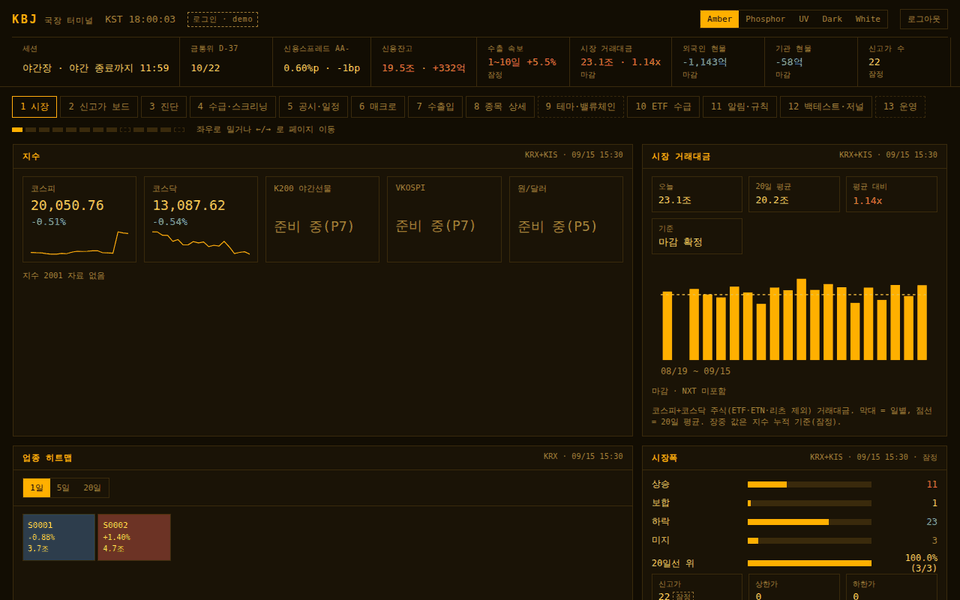
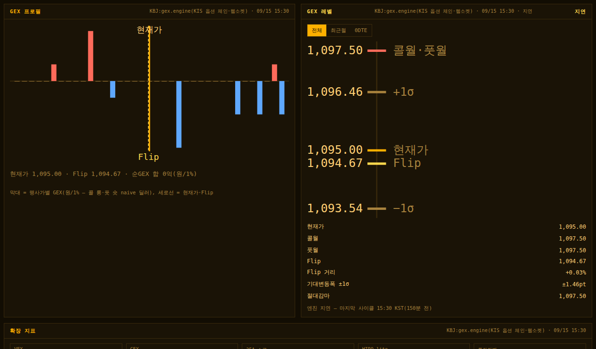
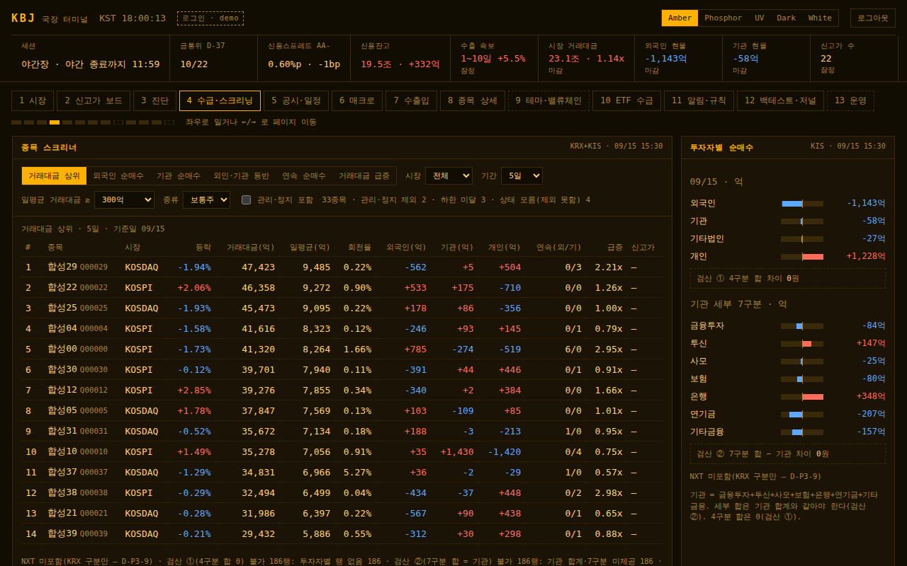
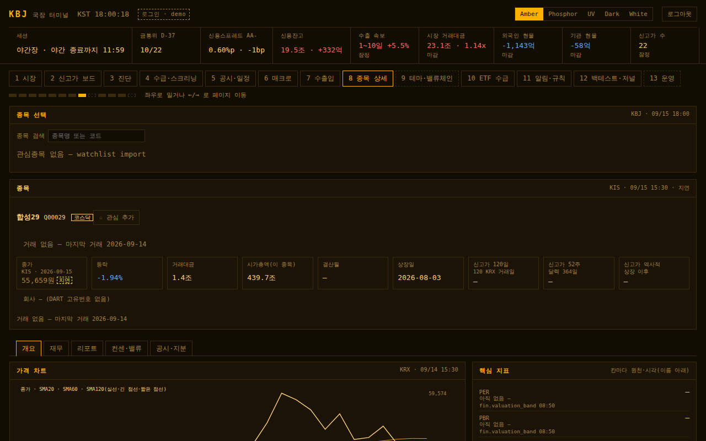
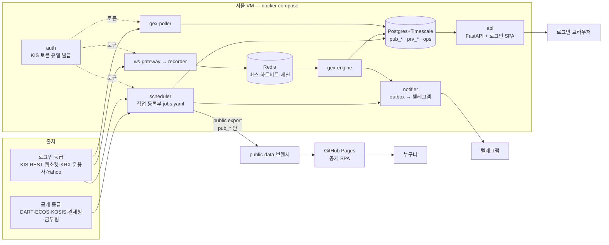

# KBJ — 국장 통합 터미널

[](https://github.com/kimbob0604-cmyk/KBJ/actions/workflows/ci.yml)

한국 주식시장을 한 화면에서 보는 개인 터미널이자 포트폴리오 프로젝트. 장중에는 시장·수급·옵션 레벨을 켜 두고 보고,
장후·월초에는 수출입·공시·재무 흐름으로 종목을 고른다. 흩어져 있던 개인 프로젝트 셋(GEXLAB·ETF-Traker·stock-dashboard)을
**정본 하나씩**(토큰 발급·외부 호출·스케줄·발송·DB)으로 다시 세웠다.

> 본 프로젝트는 투자 자문이 아니며, 표시되는 데이터·분석은 참고용이다. 실전 주문 코드는 없다(`LIVE_TRADING=false`).

## 데모 — 한 줄

```bash
docker compose -f docker-compose.demo.yml up --build     # → http://127.0.0.1:8765/
```

- 계정 **`demo`** / 비밀번호 **`kbj-demo-only`** — 데모 전용 고정값(합성 데이터만, 운영 로그인과 섞지 않는다).
- 키·DB·인터넷이 필요 없다(이미지 빌드 때 패키지만 내려받는다). 화면의 종목 이름·숫자는 **전부 합성**이다.
- 합성 세계를 싣는 데 약 2분 걸린다(그동안 health 대기). 끝내기: `docker compose -f docker-compose.demo.yml down -v`.
- 컨테이너 없이: `bash scripts/demo.sh`(로그인 SPA 빌드 + 합성 API 서버 — 비밀번호는 실행마다 무작위, 화면에 찍힌다).



| 시장 | 진단 — GEX 레벨 |
|---|---|
|  |  |
| **수급·스크리닝** | **종목 상세** |
|  |  |

미디어는 데모에서 Playwright 로 찍었다 — 만든 명령·시드·서버 시계는 [`docs/media/MANIFEST.txt`](docs/media/MANIFEST.txt).

## 13 페이지

| # | 페이지 | 등급 | 내용 |
|---|---|---|---|
| 1 | 시장 | 공개·로그인 | 지수·시장 거래대금·업종 히트맵·시장폭·투자자 수급 |
| 2 | 신고가 보드 | 로그인 | 역사적·52주·120일 신고가, 섹터·테마 집계, 랭킹 |
| 3 | 진단 | 공개·로그인 | 종합 판정·공포탐욕·시장 진단·GEX 레벨(Flip·콜월·풋월·기대변동폭) |
| 4 | 수급·스크리닝 | 로그인 | 스크리너 6기준·투자자별·기관 7구분·장중 잠정 |
| 5 | 공시·일정 | 공개·로그인 | DART 공시 피드·잠정실적·오버행·내부자·실적 일정 |
| 6 | 매크로 | 공개·로그인 | ECOS·KOSIS·FRED(정부 시리즈)·경제 캘린더 / 시장 탭(로그인) |
| 7 | 수출입 | 공개 | 관세청 10일 속보·품목·국가·지역·급등·104품목·매핑 종목 랭킹 |
| 8 | 종목 상세 | 공개·로그인 | 재무·dart-report·공시(공개) / 시세·수급·컨센서스·밸류에이션 밴드·시나리오 적정가(로그인) |
| 9 | 테마·밸류체인 | 로그인 | 자리표시 — 테마 사전 통합은 따로 진행 |
| 10 | ETF 수급 | 로그인 | 순유입·투자자별·유형별·괴리율·구성종목 변동 |
| 11 | 알림·규칙 | 로그인 | 규칙(DSL)·편집기·발송 이력·알림 후 성과 |
| 12 | 백테스트·저널 | 로그인 | 규칙 백테스트·백테스트 대 실제·분석 일지·포트폴리오·상관관계 |
| 13 | 운영 | 로그인 | 서비스 하트비트·오늘 작업·발송 기록 — 보기 전용(1주 무중단 확인) |

## 아키텍처



KIS 토큰은 `auth` 한 곳에서만 발급하고 나머지는 읽기만 한다(앱키당 리미터 하나 — 초당 4건). 수집은 작업 등록부
하나가 데이터 키를 선점해 같은 데이터를 두 번 받지 않는다. 장 마감 뒤 텔레그램은 전부 16:00 에 한 번씩 나간다.
공개/로그인 구조 분리 그림과 import 계약 표는 [`docs/architecture.md`](docs/architecture.md).

## 공개 / 로그인

재배포가 허용된 공공데이터(DART·ECOS·KOSIS·관세청·금투협 등)는 **공개** 정적 사이트(GitHub Pages)로, 약관상
재배포할 수 없는 시세·수급·컨센서스(KIS·KRX·운용사·Yahoo 등)는 **로그인** 화면(VM)으로만 보인다
— [`docs/DATA_TIERS.md`](docs/DATA_TIERS.md). 이 구분은 실행 중 검사가 아니라 **구조**로 한다:

- 코드: `kbj/data/public` ↛ `kbj/data/private`, 공개 내보내기는 로그인 등급 코드를 import 하지 않는다(import-linter).
- DB: `pub_*` 스키마만 공개 내보내기 역할이 읽는다. `prv_*`·`ops` 는 VM 안에만.
- 빌드: `dist-public`(정적 — `/api` 호출 0·로그인 출처 이름 0) 과 `dist-login` 두 벌.
- 레포: 공개다. 로그인 등급 원자료와 그것으로 만든 fixture 는 넣지 않는다(시험은 합성 세계) — 공개 산출물 검사가 막는다.

## 품질

| 무엇 | 어떻게 |
|---|---|
| 시험 | 백엔드 **8,705개**(pytest — 단위 8,441·하루 운영 시뮬레이션 127·통합 137) + 프런트 **658개**(vitest) |
| 골든 | 신고가 board·dart-report 엑셀·GEX 코어·raw 녹화 — 원본 프로젝트 출력과 허용오차로 비교 |
| 하루 운영 시뮬레이션 | 가짜 시계·가짜 서버로 하루를 돌려 토큰 발급 auth 한 곳·중복 수집 0·KIS 초당 4건 이하·16:00 발송 확인(`tests/sim`) |
| 정적 검사 | ruff·pyright(`kbj/core` strict)·eslint·tsc |
| 구조 검사 | import-linter 계약 18개, 직접 호출 금지 검사(모든 그룹 목표 0 — `scripts/check_canonical.py`) |
| 공개 산출물 검사 | 원시세·키·로그인 출처가 레포·공개 사이트·번들·데모 미디어에 없는지(`scripts/check_public_outputs.py`) |
| 번들 예산 | 공개 JS 88 KB·로그인 131 KB(gzip — `web/scripts/check-bundle.mjs`) |
| CI | lint·test·kbj-integration(TimescaleDB)·canonical·sim·web·public-outputs·demo(compose) |

커버리지 배지는 넣지 않았다(외부 배지 서비스·새 의존성 없이).

## 결정 기록(ADR)

0001~0038 — 목록·상태·대체 관계는 [`docs/adr/README.md`](docs/adr/README.md). 몇 개만:
KIS 발급 차단 세 겹 [`0004`](docs/adr/0004-kis-issuance.md) · 작업 등록부·데이터 키 선점 [`0006`](docs/adr/0006-job-registry-claims.md) ·
공개 정적 사이트 [`0011`](docs/adr/0011-public-static-site.md) · 장 마감 뒤 발송 16:00 [`0018`](docs/adr/0018-post-close-1600.md) ·
GEX 이식 경계 [`0029`](docs/adr/0029-gex-port-boundary.md) · 규칙 알림 [`0031`](docs/adr/0031-rule-alerts.md) ·
데모 모드 [`0034`](docs/adr/0034-demo-mode.md) · 공개 산출물 검사 [`0035`](docs/adr/0035-public-outputs-check.md) ·
옛 코드 비우기 [`0038`](docs/adr/0038-legacy-removal.md).

## 구조

```
kbj/            Python 3.12(uv)
  core/         순수 계산 — 값 품질(source·as_of·quality)·마스킹·거래 캘린더·지표·GEX 코어
  config/       설정(KBJ_ 환경변수 하나로 — docs/secrets.md)
  data/public/  공개 등급 어댑터      data/private/  로그인 등급 어댑터
  store/        Postgres+Timescale — pub_*·prv_*·ops, 마이그레이션 0001~0022
  engines/  services/  reports/       도메인 엔진 · 서비스(auth·scheduler·notifier·api·gex_*·ops…) · 브리핑·리포트
config/         작업 등록부 jobs.yaml · 호출 상한 limits.yaml · 발송 규칙 notify.yaml · 휴장 덮어쓰기
web/            SPA(Vite + TypeScript, 런타임 의존성 0) — 공개(정적 Pages)·로그인(같은 출처 /api) 두 빌드
tests/  scripts/  docs/
```

## 개발 명령

```bash
uv sync && uv run pytest -m "not sim and not integration"   # 단위(시뮬레이션: -m "sim and not slow", 통합: -m integration — Docker)
uv run ruff check && uv run ruff format --check && uv run pyright && uv run lint-imports
uv run python scripts/check_canonical.py                     # 직접 호출 금지 검사(정본 경계)
uv run python scripts/check_public_outputs.py                # 공개 산출물 검사(커밋 전)
cd web && npm ci --ignore-scripts && npm run lint && npm run typecheck && npm test   # 프런트(web/README.md)
docker compose up -d                                         # 로컬 DB·Redis(.env 에 KBJ_POSTGRES_PASSWORD·KBJ_REDIS_PASSWORD)
docker compose --profile app up -d --build                   # + migrate·auth·scheduler·notifier·ws-gateway·recorder·gex-engine·api
bash scripts/demo.sh --shots /tmp/shots                      # 데모 + Playwright 로 페이지 1~13(9 자리표시 제외) 스크린샷·콘솔 오류 검사
bash scripts/demo.sh --gif docs/media                        # README 미디어 다시 찍기(MANIFEST 자동)
python -m kbj.services.ops check                             # 운영 점검(VM — docs/runbook.md)
```

## 직접 해야 하는 일(키·VM·GitHub 설정)

코드로 할 수 없는 것들이다 — 순서와 명령은 [`docs/runbook.md`](docs/runbook.md).

1. **VM 운영 시작**: `.env`(키·비밀번호 — [`docs/secrets.md`](docs/secrets.md)), `docker compose --profile app up -d --build`, 매일 `ops check`.
2. **GEX 수집 전환**(옛 GX → KBJ `gex-poller`): 주말에 런북 ④ 순서로 — 그 전까지 `gex.poller` 와 GX 수집 작업은 꺼져 있다.
3. **운영 1주 무중단 판정**: 7일 동안 10분 넘는 끊김 0·켜진 작업 최종 실패 0·아침·마감 브리핑 매일 1통 — `python -m kbj.services.ops week`.
4. **GitHub Pages 공개판**(운영 1주 뒤): `main` 에 합치기 → Settings → Pages(GitHub Actions) → 배포 키·디스패치 토큰·
   `KBJ_PUBLIC_PUSH_ENABLED=true` → Actions 에서 Pages 수동 실행(런북 ⑦).
5. (선택) 옛 코드 표식: 커밋 `f6aeebd`(옮겨 온 원본을 지우기 직전)에 태그 `legacy-final` 달기.

## 문서 지도

[`docs/PLAN.md`](docs/PLAN.md)(계획·단계별 결과) · [`docs/DATA_TIERS.md`](docs/DATA_TIERS.md)(공개/로그인 정본) ·
[`docs/metrics.md`](docs/metrics.md)(지표 공식) · [`docs/probe_results.md`](docs/probe_results.md)(실측 체크리스트) ·
[`docs/runbook.md`](docs/runbook.md)(운영) · [`docs/secrets.md`](docs/secrets.md)(키·환경변수) ·
[`docs/migration/`](docs/migration/)(옮겨 온 세 프로젝트의 이식 기록) · [`docs/adr/`](docs/adr/README.md)(결정).
