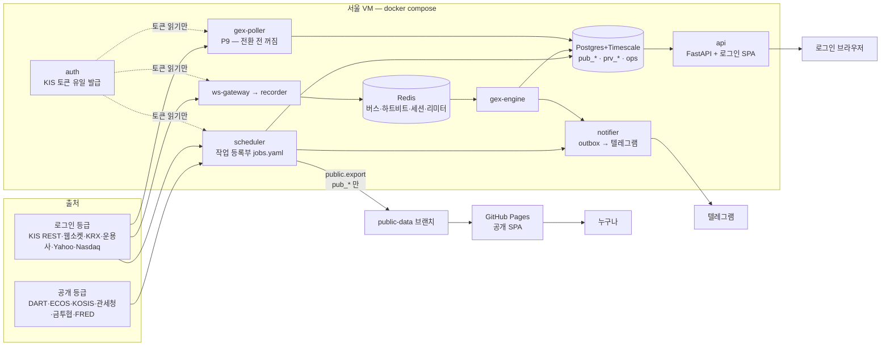
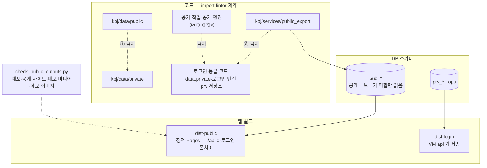

# KBJ 아키텍처

P9(2026-10-14) 기준. 정본 규칙은 [`CLAUDE.md`](../CLAUDE.md) §3·[`docs/PLAN.md`](PLAN.md) §2, 등급은
[`docs/DATA_TIERS.md`](DATA_TIERS.md), 결정은 [`docs/adr/`](adr/README.md).

## 1. 실행 구성 — 서울 VM 하나, docker compose

| 서비스(compose) | 하는 일 | 근거 |
|---|---|---|
| `auth` | KIS 접근토큰·웹소켓 접속키의 **유일한 발급자**(1분 1회 제한). 나머지는 Redis 에서 읽기만 | ADR 0004 |
| `scheduler` | 세션 상태 발행 + 작업 등록부(`config/jobs.yaml`) 실행기. 데이터 키 선점으로 중복 수집 0 | ADR 0006 |
| `notifier` | 발송 outbox 소비 → 텔레그램(발송 꺼짐이 기본). 장 마감 뒤 발송은 전부 16:00 | ADR 0005·0018 |
| `ws-gateway` → `recorder` | KIS 웹소켓 체결 → Redis 버스 → 원문 녹화(`prv_gex.raw_messages`) | ADR 0029 |
| `gex-engine` | 옵션 체인 → GEX 레벨·지표(`prv_gex.levels`…) | ADR 0029 |
| `gex-poller` | 전광판·체인·선물·최종거래일 폴링(P9 GXI 이식). **꺼진 채** — 사용자가 런북 ④ 로 옛 GX 에서 전환 | ADR 0036 |
| `api` | 로그인 API + 로그인 SPA 정적 파일(같은 출처). 외부 호출 없음 | ADR 0008 |
| `db`·`redis`·`migrate` | Postgres+Timescale 하나, Redis 하나, 마이그레이션 0001~0022 | ADR 0002 |

- 앱키당 레이트리미터 하나(초당 4건, Redis). 일 예산(KRX·DART·공공데이터포털)도 Redis 카운터 하나.
- 상시 서비스는 하트비트를 남기고 `ops.watchdog`(5분·매일 24시간)이 끊김·놓친 실행·마감 지난 실행을 찾아 알리고
  `ops.health_events` 에 끊김을 남긴다. 운영 확인은 `python -m kbj.services.ops check|week` 와 페이지 13(ADR 0037).
- 데모(`docker-compose.demo.yml`)는 위와 따로다 — 서비스 하나, 메모리 저장소 + fakeredis, 합성 세계, 외부 호출 0
  (ADR 0034).

## 2. 공개/로그인 — 실행 중 검사가 아니라 구조로

- 레포는 공개다. 로그인 등급 원천의 원자료와 그것으로 만든 fixture 는 넣지 않는다 — 시험은 `fixtures/synthetic/`
  (출처 표식 `scripts/fixture_provenance.txt`, 검사 ① — ADR 0035).
- 공개 JSON 에는 시세 칸을 두지 않는다(코드 표 `PRICE_FIELD_ALLOW` 예외만 — ADR 0035).
- 공개 번들 예산 88 KB(gzip), 로그인 번들 131 KB — `web/scripts/check-bundle.mjs`.

### import-linter 계약 (`uv run lint-imports` — 18개 유지, ②·⑮ 결번)

| # | 계약 |
|---|---|
| ① | 공개 수집기(`kbj.data.public`)는 로그인 수집기(`kbj.data.private`)를 import 하지 않는다 |
| ② | (P9 WRAP 에 삭제 — legacy/ 를 비웠다, ADR 0038) |
| ③ | `kbj.core` 는 순수 계산 — 어댑터·서비스·저장소·I/O 라이브러리 금지 |
| ④ | KIS 발급(`kbj.services.auth`)은 다른 모듈이 import 하지 않는다 |
| ⑤ | 텔레그램 HTTP(`notifier.telegram_api`)는 notifier 안에서만 |
| ⑥ | 어댑터(`kbj.data`)는 서비스·엔진·리포트를 모른다 |
| ⑦ | 저장소(`kbj.store`)는 어댑터·서비스·엔진을 모른다 |
| ⑧ | 공개 내보내기는 로그인 등급 코드를 import 하지 않는다 |
| ⑨ | 엔진(`kbj.engines`)은 순수 계산 |
| ⑩ | 로그인 API 는 로그인 원천 어댑터·수집기를 import 하지 않는다(API 는 외부 호출 없음) |
| ⑪ | 리포트는 로그인 원천·컨센서스·밸류 엔진·API 를 모른다 |
| ⑫ | 공개 엔진(공시·재무)은 컨센서스·밸류 엔진과 로그인 원천을 모른다 |
| ⑬ | 공개 작업(dart_feed·dart_company·fin·engine.filings)은 로그인 원천·엔진·저장소를 모른다 |
| ⑭ | 공개 매크로·통계 작업과 공개 원천은 로그인 원천·저장소를 모른다 |
| ⑮ | (결번 — 분류 사전은 테마 사전 작업 몫) |
| ⑯ | 브리핑·리포트는 어댑터·수집기·API 를 모른다(발송 시각 외부 호출 0) |
| ⑰ | 수출입 엔진·작업·공개 내보내기 trade 는 로그인 원천·저장소를 모른다 |
| ⑱ | 공개 진단은 로그인 원천·저장소·GEX 를 모른다 |
| ⑲ | `websockets` 는 `kbj.services.ws_gateway` 안에서만 |
| ⑳ | 개인 기록 쓰기 모듈(`kbj.services.personal`)은 원천·수집기·발송·API·작업 처리기를 모른다 |

## 3. 정본 하나씩 (두 벌 금지)

| 일 | 정본 | 검사 |
|---|---|---|
| KIS 토큰 발급 | `kbj.services.auth` | 계약 ④ + 직접 호출 검사 `kis_oauth` |
| KIS·KRX·DART·공공 API 호출 | `kbj/data/{public,private}` 어댑터 | `scripts/check_canonical.py`(모든 그룹 목표 0 — P9) |
| 텔레그램 | `kbj.services.notifier` | 계약 ⑤ + `telegram` 그룹 |
| 스케줄 | `config/jobs.yaml` 등록부 하나 | `python -m kbj.services.scheduler validate` |
| 거래 캘린더 | `kbj.core.calendar`(GEXLAB 출신) | — |
| 신고가 | `kbj.engines.board` | 골든 |
| 기술 지표 | `kbj.core.indicators` | `ta_indicators` 그룹 |
| DB | Postgres+Timescale 하나 | — |

옮겨 온 원본 세 프로젝트(GEXLAB·ETF-Traker·stock-dashboard)는 P1 에 `legacy/` 로 들어와 P2~P9 동안 정본으로
갈아 끼운 뒤 P9 에 비웠다 — 마지막 상태는 커밋 `f6aeebd`, 이식 기록은 [`docs/migration/`](migration/).
