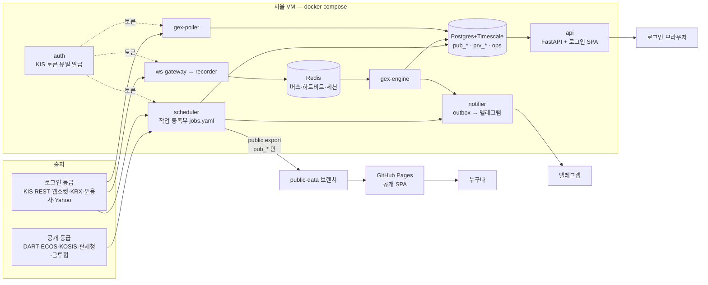

# KBJ P9 설계서 — 포트폴리오 마감 (데모·공개 산출물 검사·legacy 비우기·운영 준비)

- 작성: 2026-10-14. 상태: **설계(구현 전)**. 대상 단계: `docs/PLAN.md` §8 P9(3~4일), §6(포트폴리오로 보여 줄 것), D3·D8.
- 기준 코드: 브랜치 `claude/build` HEAD `c55dfa0`(P0~P8 완료, CI 녹색). 원격 `main` 은 첫 커밋 `2ebcf34` 하나뿐이다(§5 — Pages 배포 조건과 관계).
- 기준 문서: 계획 `docs/PLAN.md`, 등급 `docs/DATA_TIERS.md`(정본), ADR 0003(legacy 범위)·0007(legacy 브리지)·0011(공개 정적 사이트)·0025(공개 JS 예산)·0029(GEX 이식 경계)·0031(규칙 알림), 설계서 `docs/p7_design.md`·`docs/p8_design.md`(형식·관례), `legacy/*/MIGRATION.md`.
- 표기: **[추정]** = 코드로 끝까지 확인하지 못함, **[확인 필요]** = 기본값으로 정한 것, **[제안]** = 이 설계의 권고, **[사용자]** = 사용자만 할 수 있는 일, ⚠ = 위험.
- 키·토큰·계좌 값은 이 문서에 없다. `.env`·토큰 캐시는 열지 않았다. 실데이터는 레포에 넣지 않는다 — 데모·GIF·시험은 전부 **합성 세계**(고정 시드)로 만든다. 원래 레포(stock-dashboard·ETF-Traker·GEXLAB)는 건드리지 않는다.
- 번호 규칙: ADR 은 `docs/adr` 마지막(0033) 다음 **0034 부터**(0020 은 비어 있다 — 그대로 둔다). probe 체크리스트는 #67 다음 **#68 부터**. 마이그레이션은 0021 다음 **0022**(필요할 때만).

**코드로 확인한 사실 중 이 설계의 출발점**

1. `legacy/` 는 아직 **559 파일·파이썬 103,690줄**(전체 159,887줄)이다. 그중 **운영에서 실제로 도는 것은 GX 수집 경로뿐**이다 — 등록부 `config/jobs.yaml` 의 `runner: external` 다섯 줄(`gex.poller`·`gex.day_minutes`·`gex.night_minutes`·`kis.master`·`gex.krx_derivatives`, owner `legacy:gexlab/...`). ET·SD 코드는 KBJ 의 compose·등록부 어디에서도 실행되지 않고 **CI 시험으로만** 돈다(§1).
2. `docker compose up` 은 지금 **`.env` 가 없으면 시작하지 않는다**(`docker-compose.yml` x-urls 의 `${KBJ_POSTGRES_PASSWORD:?…}`). 그리고 기본 서비스는 db·redis 뿐이다. 데모 서버(`scripts/demo_p3_server.py`)는 `tests/` 의 합성 세계·`fakeredis`(dev 그룹)에 기대는데, 앱 이미지(`Dockerfile`·`.dockerignore`)는 `tests`·`scripts`·dev 의존성을 뺀다 — **지금 이미지로는 데모가 뜨지 않는다**(§2).
3. 데모 서버는 `127.0.0.1` 에만 묶고(`LOOPBACK`), 비밀번호는 **12자 이상**을 요구하며(`len(password) < 12` 면 종료 2), 설정 검증은 `web_cookie_secure=False` 일 때 루프백이 아니면 거절한다(주석 :245). 컨테이너 안에서는 묶을 주소를 따로 둬야 한다(§2.3).
4. 공개 안전 검사는 세 갈래로 이미 있다 — 레포 파일(`scripts/check_public_safety.py` — 비밀 형태·데이터 확장자·5MB), 공개 데이터(`kbj/services/public_export/manifest.py`·`web/scripts/merge-public-data.mjs` — 로그인 출처 이름·관심종목 흔적·`trade/stock` 시세 칸·진단 판정 키), 공개 번들(`web/scripts/check-bundle.mjs` — 로그인 API 문자열·예산). **'원시세가 없다' 를 레포 fixture 와 공개 번들 전체에 대해 보는 검사는 없다**(§3).
5. 공개 페이지 3 로그인 본문 분리(P7 남은 것 ⑧)는 **P8 WRAP 에서 이미 끝났다**(PLAN P8 결과 '프런트' 줄 — 공개 JS gzip 79,276 B). P9 할 일 아님.
6. 페이지 13(운영)은 P8 에서 뺐다(P8 §10 Q9 — `web/src/app/pages.ts` 자리표시 '단계 미정'). 운영 1주 확인에 쓸 화면 후보다(§6, §10 Q5).
7. kbj 쪽에서 legacy 파일을 직접 읽는 시험·코드가 **약 20개 파일**이다(§1.2). 일부는 파일이 없으면 **조용히 건너뛴다**(`skipif(not … .exists())` — `tests/unit/kis/test_kis_rest.py`:313, `tests/unit/auth/test_owner_compat.py`:107). 지우면 시험 수가 소리 없이 줄 수 있다 ⚠.

---

## 0. 요약

### 0.1 결정 요약

| # | 결정 | 이유·근거 |
|---|---|---|
| D-P9-1 | **데모 = 별도 compose 파일 `docker-compose.demo.yml` 하나, 서비스 하나(`demo`)**. 명령은 `docker compose -f docker-compose.demo.yml up --build` 한 줄 → `http://127.0.0.1:8765/`. 기본 `docker-compose.yml` 에 프로파일로 넣지 않는다 | 기본 파일은 `.env` 필수 변수(`:?`)가 있어 키 없는 데모를 같은 파일로 띄우면 보간 단계에서 실패한다 [추정 — compose 는 프로파일과 상관없이 파일 전체를 보간한다, DEMO 가 실측]. 데모는 운영 스택과 섞이지 않는 편이 안전하다 |
| D-P9-2 | **데모 저장소 = 메모리 저장소 + fakeredis(한 프로세스)**, 데이터 = 기존 합성 세계(`api_world` + p6·p7·p8 세계). Pg 모드(`demo_p3.sh --db`)는 개발용으로 남기고 compose 데모에 넣지 않는다 | Pg 모드는 페이지 3·11·12 를 싣지 않는다(`demo_p3_server.py` — `KBJ_DEMO_DATABASE_URL` 이면 `_load_p7`·`_load_p8` 건너뜀). 컨테이너 하나가 가장 빨리 뜬다 |
| D-P9-3 | **데모 이미지 = `Dockerfile.demo` + 그 파일 전용 `Dockerfile.demo.dockerignore`(허용 목록 방식)**. 1단계 node 가 로그인 SPA 빌드, 2단계 python 이 `kbj/`·`config/`·`scripts/demo_server.py`·데모가 import 하는 `tests/` 하위만 넣는다. 의존성은 런타임 + 새 그룹 `demo`(`fakeredis[lua]` 하나) | 앱 이미지·`.dockerignore` 를 바꾸지 않는다(운영 이미지에 시험 코드가 들어가지 않게). 파일 이름별 dockerignore 는 GX 가 이미 쓰는 방식(`legacy/gexlab/Dockerfile.dockerignore`) |
| D-P9-4 | **데모 계정 = 사용자 `demo` + 고정 비밀번호**(기본 `kbj-demo-only` — 13자, README 에 적는다, 환경변수로 바꿀 수 있다) [§10 Q3] | 호스트 루프백에만 열리고 데이터는 전부 합성이라 숨길 것이 없다. GIF·README 안내가 쉬워진다 |
| D-P9-5 | **데모의 외부 호출 0 은 시험으로 증명**: 합성 세계 적재 + 대표 API 호출 동안 루프백 밖 소켓 연결을 막는 시험(`tests/unit/demo/test_demo_offline.py`). 컨테이너에는 키 환경변수를 하나도 넣지 않는다 | 로그인 빌드에는 TradingView 가 없다(`check-bundle.mjs LOGIN_FORBIDDEN`). 공개 빌드는 TradingView 위젯을 부르므로 데모에 넣지 않는다(§10 Q8) |
| D-P9-6 | **공개 산출물 검사 = 새 우산 스크립트 `scripts/check_public_outputs.py`** 하나가 ① 레포 파일(기존 검사 + 새 규칙 `fixture_provenance`) ② 공개 사이트 산출(공개 데이터 검사 + 번들 전체의 비밀 형태·로그인 출처 이름·시세 칸) ③ 데모 미디어(`docs/media/**`) ④ 데모 이미지 입력(`Dockerfile.demo.dockerignore` 허용 목록)을 차례로 보고 종료 코드 하나를 낸다. 기존 검사는 그대로 두고 **불러 쓴다**(두 벌 금지) | PLAN P9 완료 기준 '원시세·키가 없는지 검사하는 스크립트' 를 한 명령으로 |
| D-P9-7 | **GX 수집 경로를 P9 에 KBJ 로 이식(묶음 GXI)** [§10 Q2]: poller → KBJ 상시 서비스 `gex.poller`, 분봉·KRX 파생·마스터 → 등록부 작업(runner kbj), GX `PostgresSink` 쓰기 → KBJ 저장소 + 디스크 스풀. 투자자별 죽은 코드(`collector._on_investor`)는 옮기지 않는다. 운영 도구는 `nogap_report`·`shadow_report` 만 옮긴다(probe #61·#62 에 필요), `metric_report`·`validate_greeks`·`probe_*` 는 옮기지 않는다(원본 GEXLAB 레포에 있다) | 운영 중인 유일한 legacy. 이것이 남으면 `legacy/` 를 비울 수 없다(PLAN D8). P7 이 미룬 이유(state_enter 트리거)는 등록부가 이미 `state_enter` 를 지원한다(`config/jobs.yaml` 머리말 :7) |
| D-P9-8 | **legacy 비우기 = 두 단계**: 웨이브 2 의 LEGACY 가 ET·SD(운영 안 함)와 kbj 쪽 다리(`kbj/data/legacy_bridge.py`·notifier legacy shim·`legacy_kinds`)를 지우고, 웨이브 3 의 WRAP 이 GXI 가 끝난 뒤 `legacy/gexlab` 과 `legacy` 의존성 그룹·CI 잡·ADR 0003 제외 설정을 지운다 | ET·SD 는 GX 와 무관하게 먼저 지울 수 있다(브리지·shim 을 쓰는 것은 ET board 4·SD 4 파일뿐 — GX 는 안 쓴다, grep 확인) |
| D-P9-9 | **지우기 직전 커밋에 태그 `legacy-final`** [§10 Q1] — 보관 브랜치는 만들지 않는다. 각 `MIGRATION.md` 는 `docs/migration/<프로젝트>.md` 로 옮겨 기록을 남긴다 | 태그 하나로 언제든 꺼내 볼 수 있고 브랜치처럼 갈라지지 않는다. 원본 레포 3개는 그대로다 |
| D-P9-10 | **대체 없는 legacy 기능은 버린다**(§1.3 표 — 스윙 신호·구루 X·flowlab 이벤트 스터디·SD 발굴 추천·SD 뉴스/옵션 등) [§10 Q10]. 테마·밸류체인(페이지 9) 관련 legacy 도 지운다 [§10 Q9] | 사용자가 앞서 버리기로 한 것(SWG 없음 — P8, 구루 X 제외 — P5 Q4)과 같은 기준. 원본 레포·태그에 남는다 |
| D-P9-11 | **`pct_rank` 하나로**: `kbj.engines.diagnosis.bands.pct_rank`(Decimal)를 `kbj.core.indicators.pct_rank` 호출 + Decimal 양자화로 바꾼다. P7 진단 골든·명세 시험이 그대로 녹색이어야 한다 | ADR 0031 '[제안] P9 에서 하나로' |
| D-P9-12 | **운영 1주 무중단은 코드로 '확인 수단' 만** 만든다: 점검 CLI(`python -m kbj.services.ops check`·`week`), 페이지 13 최소판(읽기 전용 표 셋) [§10 Q5], 런북 `docs/runbook.md`. 실제 1주 운영·판정은 [사용자] | 실제 VM·키·텔레그램이 필요하다. 판정 기준은 §6.1 [§10 Q6] |
| D-P9-13 | **README = 처음부터 다시**(지금은 'P3 상태'): 한 장 요약 → 데모 한 줄 → GIF → 13 페이지 표 → 아키텍처 그림(mermaid) → 공개/로그인 → 품질(CI 배지·시험 수 글자 — 커버리지 배지는 넣지 않는다 [제안]) → ADR 요약 → 개발 명령 → 면책 | PLAN §6. 커버리지는 새 의존성(pytest-cov)·외부 배지 서비스가 필요해 뺀다 |
| D-P9-14 | **GIF = Playwright 스크린샷 → Pillow 로 조립**(ffmpeg 없음). 960px 폭·프레임 10장 안팎·**3MB 이하**, 정지 화면 PNG 4장. `docs/media/` 에 커밋하고 만든 명령·시드를 `docs/media/MANIFEST.txt` 에 적는다 [§10 Q4] | Pillow 는 matplotlib 의존성으로 이미 들어온다 [추정 — DEMO 가 `uv pip show` 로 확인]. 공개 안전 검사의 5MB 상한 안 |
| D-P9-15 | **Pages 켜기는 [사용자] 조치 목록으로만**(§5) — 코드는 바꾸지 않는다(`pages.yml` 은 이미 수동 배포). 기본은 운영 1주 뒤에 켠다 [§10 Q7] | 공개 데이터는 VM 의 `public.export` 가 올린다. 그 전에 켜면 빈 화면이 많다 |

### 0.2 만드는 것 / 만들지 않는 것 (P9 경계)

| 만든다 (P9) | 만들지 않는다 |
|---|---|
| `docker-compose.demo.yml`·`Dockerfile.demo`·데모 스크립트 이름 정리(`demo.sh`·`demo_server.py`·`demo_shots.mjs`)·GIF 도구 | 공개 Pages 에 올리는 '서버 없는 데모'(§10 Q8 — 기본 안 함), 데모용 실데이터 스냅샷 |
| `scripts/check_public_outputs.py`·`fixture_provenance` 규칙·번들 비밀 형태 검사·공개 JSON 시세 칸 규칙 | git 이력 전체 검사(공개 레포는 처음부터 깨끗하게 시작 — DATA_TIERS §4) |
| GX 수집 이식(poller 서비스·분봉·KRX 파생·마스터·무결측·쓰기·nogap/shadow 보고) | GX `metric_report`·`validate_greeks`·`probe_*` 이식, 웹소켓 주식 실시간 시세 |
| legacy 전부 삭제·태그·`docs/migration/`·kbj 다리 제거·`pct_rank` 하나로·`legacy_kinds` 정리 | 테마·밸류체인(페이지 9) — 사용자가 따로 진행(P5 결정 Q1) |
| 점검 CLI·주간 판정·페이지 13 최소판·런북 | 실제 VM 운영·키 발급·Pages 활성(전부 [사용자]) |
| README·아키텍처 그림·ADR 0034~0038·ADR 목록 `docs/adr/README.md` | 글꼴 자체 호스팅(P3 [제안 — P9] → 하지 않음, 시스템 글꼴 그대로), 커버리지 배지 |

### 0.3 완료 기준과 증명

| PLAN §8 P9 완료 기준·항목 | 증명 | 묶음 |
|---|---|---|
| **`docker compose up` 한 줄로 데모가 뜬다** | ① CI 잡 `demo (compose)`: `docker compose -f docker-compose.demo.yml up -d --build` → `/api/health` 200 → 데모 계정 로그인 → 페이지 1·2·3·4·5·7·8·10·11·12 API 대표 경로 200(데이터 칸 있음) → `down -v`. ② 로컬 `bash scripts/demo.sh --compose --shots DIR`(Playwright — 콘솔 오류·실패 요청 0, 패널 오류 0). ③ `tests/unit/demo/test_demo_offline.py`(외부 연결 0) | DEMO, WRAP(CI 잡) |
| **공개 산출물에 원시세와 키가 없는지 검사하는 스크립트가 통과한다** | `uv run python scripts/check_public_outputs.py` 종료 0(CI 잡 `public-outputs`) + 일부러 넣은 위반 사례마다 1 을 내는 시험(`tests/test_public_outputs.py` — 비밀 형태·로그인 출처·시세 칸·출처 표식 없는 fixture·큰 GIF·dockerignore 누락) | DEMO |
| (항목) README·아키텍처 그림·GIF | README 렌더 확인(mermaid 2개), `docs/media/kbj_demo.gif` ≤ 3MB, README 의 모든 상대 링크가 있는 파일을 가리키는지 보는 시험(`tests/test_readme_links.py`) | DEMO(미디어), WRAP(README) |
| (항목) ADR | 0034~0038 확정, `docs/adr/README.md` 목록(번호·제목·상태·대체 관계), 0003·0007 '대체됨' 표시 | 각 묶음 초안, WRAP 확정 |
| (항목) `legacy/` 비우기 | `git ls-files legacy | wc -l` = 0, `test_legacy.sh`·CI legacy 잡 없음, `check_canonical` 기준선 빈 표, import-linter 녹색, 시험 수 표(§7.5 — 줄어든 수 = 승격 + 폐지, 항목별 사유) | LEGACY, GXI, WRAP |
| (항목) 운영 1주 무중단 | 코드: `ops check`·`ops week` 가 sim 데이터로 손계산과 같은 판정(`tests/sim/test_ops_week.py`), 페이지 13 웹 시험, 런북. **실제 1주는 [사용자]** — 결과(통과/실패 숫자만)를 PLAN P9 결과에 적는다 | OPS, [사용자] |
| 백엔드 ruff·pyright·pytest·lint-imports·check_canonical·check_public_safety, 프런트 eslint·tsc·vitest·빌드·번들 검사, CI 녹색 | §7.4 WRAP 명령 | WRAP |

### 0.4 앞 단계가 P9 로 미룬 것 — 빠짐없이(`grep -rn 'P9'` docs·legacy MIGRATION·config·kbj·scripts, 2026-10-14)

| # | 미룬 것 | 출처 | P9 처리 | 묶음 |
|---|---|---|---|---|
| 1 | GX 수집 경로(poller·분봉·KRX 파생·마스터·무결측·개장 확인) 이식 | p7 D-P7-4·Q1, ADR 0029 §1·§3-7, `config/jobs.yaml`:41·69·208·231·283·677, `0020_diag.sql`:167~169 COMMENT, `legacy/gexlab/MIGRATION.md` P7 | KBJ 로 이식(D-P9-7) | GXI |
| 2 | GX poller 투자자별 죽은 코드(`collector._on_investor`) | ADR 0029 §3-6, GX MIGRATION P7.2 | 옮기지 않음 → legacy 와 함께 삭제 | GXI·WRAP |
| 3 | legacy GX poller 에 KIS 키 주입 | `docs/secrets.md`:128 | KBJ `gex-poller` 서비스로 바꿔 적음 | GXI |
| 4 | board 스윙 엔진(`signals`·`backtest`·`search`·`systems`)·US `btsearch`·`config/signals.yaml` | P8 사용자 결정(SWG 없음), `canonical_baseline.txt` `ta_indicators` board 6 | 삭제(이식 안 함) | LEGACY |
| 5 | SD 차트 지표 `_calc_rsi_macd`·`_calc_adx`·`_calc_bollinger` | p8 §1.7, 기준선 SD 4 | 삭제(SD `server.py` 통째) | LEGACY |
| 6 | SD 일지 helper 모듈(`analysis_journal_api`·`analysis_journal_helper`·`review_validator`·`valuechain`) | P8 WRAP 기록, SD MIGRATION P8 | 삭제 | LEGACY |
| 7 | `pct_rank` 두 구현 합치기 | ADR 0031 :77~79, PLAN P8 남은 것 ⑤ | D-P9-11 | LEGACY |
| 8 | `config/notify.yaml legacy_kinds` #6·#12·#13 줄 | p8 WRAP 기록, SD MIGRATION P8, `notify.yaml`:137 | `legacy_kinds`·`legacy_default_kind`·종류 `legacy.other`·client shim 전부 삭제 | LEGACY |
| 9 | `kbj/data/legacy_bridge.py` 삭제 | ADR 0007 §35, p2 §212, 모듈 머리말 :29 | 삭제 + 계약 ⑯ 금지 목록에서 뺌 | LEGACY |
| 10 | ADR 0003 §2-7 — `legacy/` 비우고 제외 설정·`legacy` 의존성 그룹 삭제 | ADR 0003, `pyproject.toml`:60 | 삭제, ADR 0038 이 0003 대체 | WRAP |
| 11 | monitor/kr 전부·ETF 분류 두 번째 사본 `monitor/kr/etf.py` | p5 §236·R14 | 삭제(페이지 9 는 사용자 별도) | LEGACY |
| 12 | 공개 JS 예산 88 KB '화면 이전 여유' | ADR 0025 :47 | legacy 화면을 옮기지 않으므로 예산 그대로. 페이지 13 은 로그인 전용(공개 번들 0) | OPS |
| 13 | 페이지 13 운영 | p8 §10 Q9, `pages.ts` 주석 | 최소판(§10 Q5) | OPS |
| 14 | 원문 30일 Parquet 내보내기·보존 정책 '운영' | p7 R9 | 런북에 보존 메모·점검 CLI 가 표 크기 보고(코드로 내보내기는 안 함) [제안] | OPS |
| 15 | `prv_board.*` 압축 여부 '크기는 P9 에' | `0007_board.sql`:81 | 점검 CLI 가 표 크기를 보고, 결정은 운영 1주 데이터 뒤 | OPS |
| 16 | 글꼴 자체 호스팅 | p3 :596 [제안 — P9] | 하지 않음(시스템 글꼴) | — |
| 17 | 공개 페이지 3 로그인 본문 분리 | p7 남은 것 ⑧ | **이미 완료(P8 WRAP)** — 확인만 | — |
| 18 | 데모 모드 참고(ET `--demo`·GX golden) | `docs/inventory.md`:437 | 참고만 — KBJ 데모는 합성 세계 | — |
| 19 | 등록부 `phase` 허용 P2~P9 | `registry.py`:289 | 새 작업·서비스는 `phase: P9` | GXI |

P9 범위 밖(명시적으로 남김 — 앞 단계 '남은 것' 중 P9 표시가 없는 것): 실측 체크리스트(#1~#67 중 미완 — 키 수령 뒤), 엔진 쓰기 디스크 스풀 공용화(P7 ⑦ — GXI 는 GX 쓰기만 KBJ 스풀로, 엔진 쪽은 다시 볼 때), 테마·밸류체인 사전 통합(사용자 별도), SD 옛 발송 이력 미이관 확인(P8 ④ — [사용자]).

---

## 1. 현황 — legacy 폴더별 (2026-10-14, `git ls-files` 로 셈)

### 1.1 폴더별 표

'운영 참조' 칸은 루트 `docker-compose.yml`·`config/jobs.yaml`·`.github/workflows/ci.yml`·`scripts/test_legacy.sh` 에서 찾은 것이다. **원래 레포는 건드리지 않는다**(지워도 원본·태그에 남는다).

| legacy 폴더 | 파일 / 파이썬 줄(전체 줄) | 운영 참조 | KBJ 대응 위치 | 처리안 |
|---|---|---|---|---|
| `gexlab/services/poller` | 12 / 2,244 | **운영 중**: 등록부 `gex.poller`(runner external), 쓰기 `prv_gex.chain_snapshots`·`fut_board`·`series_expiries` | 없음 → `kbj/services/gex_poller/`(새) | **이식이 먼저**(GXI) |
| `gexlab/services/scheduler` + `services/gaps.py` | 8 / 2,609 + gaps | **운영 중**: `gex.day_minutes`·`gex.night_minutes`·`kis.master`·`gex.krx_derivatives`(runner external) | 등록부 실행기 + `kbj/services/collectors/gex_*.py`(새) | **이식이 먼저**(GXI) |
| `gexlab/data/store.py`(PostgresSink)·`data/spool.py`·`db/` | 2,123 + 47 + 157 | 운영 중(위 둘의 쓰기) | `kbj/store`(0006·0020 표는 있음) + `kbj.store.spool` | **이식이 먼저**(GXI — 쓰기 부분만) |
| `gexlab/data/kis`·`data/krx` | 7·3 / 218·109 | shim(KBJ 다시 내보내기) | `kbj.data.private.kis.*`·`krx.*` | 삭제(WRAP) |
| `gexlab/core`·`services/{engine,ws_gateway,recorder,auth}`·`services/{bus,chain_feed,runtime,healthcheck}.py`·`config` | 약 40 / 약 500 | shim(P7) — 운영은 KBJ 서비스 | `kbj.core.gex`·`kbj.engines.gex`·`kbj.services.*` | 삭제(WRAP) |
| `gexlab/scripts` | 19 / 9,134 | 운영 도구(사람이 실행). `nogap_report`·`shadow_report` 는 probe #61·#62 | `nogap`·`shadow` → `python -m kbj.services.engine.gex_report`(새) | 둘 이식(GXI), 나머지 삭제(WRAP) — `make_synthetic_fixtures.py` 는 fixture 와 함께 `tests/fixtures/synthetic/gex/` 로 이동(GXI) |
| `gexlab/tests` | 74 / 16,686 | CI `legacy (gexlab)` **760**·`gexlab-integration` **39** | 승격 대상: poller·scheduler·gaps·store·spool·master·full_day·nogap·shadow 시험 → `tests/unit/gex_ingest/`·`tests/integration/` | 수집 시험 승격(GXI), GX 레포 규칙·도구 시험 폐지(WRAP — §7.5) |
| `gexlab/{Dockerfile,docker-compose.yml,uv.lock,pyproject.toml,docs,CLAUDE.md,README.md}` | — | GX compose 는 통합 시험(`test_compose`)과 **운영 VM 의 GX 기동**[추정] | 루트 `docker-compose.yml`(+ `gex-poller`) | 삭제(WRAP) — VM 전환은 [사용자](§6.3) |
| **gexlab 합계** | **221 / 34,837 (40,785)** | | | |
| `etf_traker/board` | 200 / 35,250 (54,124) | 실행 없음(등록부 `absorbs`·`retired` 로 전부 정리). CI `legacy (board)` **1,039** | 신고가 `kbj.engines.board`(P3), US `kbj.engines.us`(P5), 공시 트리거 P4 | 삭제(LEGACY) — 스윙·btsearch·xdigest·guru·news 는 대체 없이 버림(§1.3) |
| `etf_traker/monitor/kr` | 22 / 3,440 (8,960) | 실행 없음(`themes.monitor` 꺼짐 — 페이지 9 사용자 별도). CI `kr` **94** | (페이지 9 — 사용자 별도) | 삭제(LEGACY) [§10 Q9] |
| `etf_traker/flowlab` | 17 / 2,684 | 실행 없음. CI `flowlab` selftest **44/44** | 수급 원장 `kbj.engines.flows`, 이벤트 스터디는 없음 | 삭제(LEGACY) |
| `etf_traker/dart-report` | 17 / 622 | shim(P4 — `kbj.reports.dart_excel`). CI 스모크 + 다리 | `kbj.reports.dart_excel` | 삭제(LEGACY). 골든 생성기는 옛 커밋을 `git archive` 하므로 그대로 동작(`tests/golden/dart_report/make_golden.py`:435) |
| `etf_traker/etf_tracker_v9` | 11 / 402 | shim. CI import 스모크 **8** | `kbj.data.private.etf_issuers`·`etf.collect`·`etf.report` | 삭제(LEGACY) |
| `etf_traker/` 루트(`.github/workflows` 5·`MIGRATION.md`·문서 2) | 8 | 실행 안 됨(루트 `.github` 아님 — ADR 0003 §2-6) | — | 삭제, MIGRATION → `docs/migration/etf_traker.md` |
| **etf_traker 합계** | **276 / 42,398 (69,303)** | | | |
| `stock_dashboard` | 62 / 26,455 (49,799) — `server.py` 14,216줄 | 실행 없음(compose·등록부에 없음, SD 정기 작업은 `retired`/`absorbs`). CI `stock_dashboard` 래퍼 **13** | P3~P8 각 페이지·작업 | 삭제(LEGACY) — `kbj.store.legacy_import`(SD sqlite → KBJ 이관 도구)는 **남긴다**(레포의 legacy 코드가 아니라 VM 의 SD 자료를 읽는다) |
| **legacy 전체** | **559 / 103,690 (159,887)**, 그중 시험 파이썬 32,987줄 | | | |

**지울 수 있는 것(웨이브 2 — LEGACY)**: `etf_traker/**`, `stock_dashboard/**` — 운영 참조 없음, kbj 다리 두 개(`legacy_bridge`·notifier shim)만 같이 지우면 된다.
**이식이 먼저인 것(웨이브 2 GXI → 웨이브 3 WRAP 이 삭제)**: `gexlab/**` — 수집 경로가 운영 중.

### 1.2 kbj 쪽에서 legacy 를 아는 코드·시험 (지우면 같이 바뀐다)

| 파일 | 무엇을 읽나 | 처리 | 묶음 |
|---|---|---|---|
| `kbj/data/legacy_bridge.py`·`tests/unit/data/test_legacy_bridge.py` | ET board 4·SD 4 파일이 쓰는 논리 URL 다리 | 삭제(ADR 0007 대체) | LEGACY |
| `kbj/services/notifier/client.py`(legacy shim·`legacy_kinds` 찾기)·`policy.py`(`legacy_kinds` 칸)·`config/notify.yaml`(`legacy_kinds`·`legacy_default_kind`·`legacy.other`)·`tests/unit/notifier/test_client_shim.py` | ET board 3·SD 1 의 kind 없는 발송 | 삭제 | LEGACY |
| `tests/sim/harness.py`(:122·:1515 — 'legacy' 소비자)·`tests/sim/test_one_day.py`(:32·:298)·`test_token_rejected.py`·`test_brief_once.py`(:114 SD `server.py`, `legacy_send`) | legacy 소비자 흉내 | 'legacy' 소비자 제거, 기대값 갱신(사유 기록) | LEGACY |
| `tests/unit/core/test_legacy_holiday_parity.py` | SD `server.py` 휴장일 | 삭제(대조 끝 — 결과는 `docs/migration/stock_dashboard.md` 에) | LEGACY |
| `tests/unit/engines/board/test_build_source.py`·`test_config.py`(:90) | ET board `engine/build.py`·`config/settings.yaml` | 원본 값을 시험 안 상수로 동결(P5 tracker DDL 방식) | LEGACY |
| `tests/unit/engines/etf/test_legacy_shim.py`·`tests/unit/reports/test_legacy_shim.py`(마커 `legacy`) | ET shim | 삭제 | LEGACY |
| `tests/golden/board/make_golden.py`·`recapture.py`·`META.json` | ET board 엔진(재생성용) | 재생성 불가 표시(골든 값·시험은 그대로) — 다시 만들 땐 태그 `legacy-final` 에서 | LEGACY |
| `tests/test_store_layout.py` | :406 ET board `db.py` / :242 GX 마이그레이션 / :196 `.dockerignore` 의 `legacy` | ET 부분 동결(LEGACY), GX 부분 동결·dockerignore 단언 갱신(WRAP) | LEGACY·WRAP |
| `tests/unit/kis/test_kis_master.py`(:35)·`tests/unit/data/private/test_private_synthetic_fixtures.py`(:17) | GX 합성 fixture `tests/fixtures/{kis,krx}` | fixture 를 `tests/fixtures/synthetic/gex/{kis,krx,validation}` 로 `git mv`, 경로만 | GXI |
| `tests/unit/kis/test_kis_rest.py`(:49·:313)·`tests/unit/auth/test_owner_compat.py`(:36·:107) | GX 스크립트·`auth_client.py` 를 하위 프로세스로(없으면 **skip**) | ⚠ 조용한 skip 이 되지 않게 그 항목을 **삭제**하고 사유를 적는다 | GXI |
| `tests/acceptance/test_p7_golden_spec.py`(:69) | `legacy/gexlab/MIGRATION.md` | 경로 → `docs/migration/gexlab.md` | WRAP |
| `tests/test_gitignore.py`·`tests/test_import_contracts.py`(:89 계약 ② 사례)·`tests/test_public_safety.py`(:212 `exclude=["legacy"]`)·`tests/test_check_canonical.py` | 규칙 시험 | 사례 갱신 | WRAP·WRAP·DEMO·LEGACY |
| `scripts/check_canonical.py`·`scripts/canonical_baseline.txt`·`scripts/test_legacy.sh` | legacy 검사·기준선 | §7.6 | LEGACY·WRAP |
| 그대로 두는 것 | `kbj/store/legacy_import/**`·`kbj/engines/rules/legacy_sd.py`(SD 자료 이관 — VM 파일을 읽는다), `tests/fixtures/synthetic/sqlite/make_legacy_db.py`(합성 SD DB 생성 — legacy 폴더를 읽지 않는다), `tests/golden/dart_report/make_golden.py`(옛 커밋 `git archive`), `tests/unit/kis/test_invalidate_guard.py`(문자열 'legacy' 뿐) | — | — |

### 1.3 지우면 사라지는 기능 — KBJ 에 대체가 없는 것 (원본 레포에는 남는다)

| 기능 | 원래 위치 | 상태 |
|---|---|---|
| 스윙 신호·백테스트·조합 탐색·US btsearch | ET `board/engine/{signals,backtest,search,systems}`·`board/us/btsearch` | 사용자 결정(2026-10-13 SWG 없음) — DSL 백테스트(페이지 12)가 대신 |
| 구루 X 다이제스트·guru | ET `board/xdigest`·`board/guru` | 사용자 결정(P5 Q4 — 완전 제외) |
| flowlab 수급 이벤트 스터디 | ET `flowlab/eventstudy.py` 등 | 대체 없음 [추정 — kbj 에 `event_study` 없음, grep] |
| SD 발굴·추천 생성기·추천 이력 저장 | SD `server.py` | P8 '만들지 않음' — 이관한 추천 성과(읽기)만 페이지 12 |
| SD 뉴스·피어 유니버스·yfinance 옵션·LLM 에이전트(`agents/pipeline.py`) | SD | 대체 없음 [추정] — 옵션은 등록부 `retired`(`SD:refresh_options`) |
| ET board 뉴스·gnews·bsky 수집 | ET `board/ingest` | 대체 없음 [추정] |
| 테마 강도·테마/밸류체인 사전·`theme_crawler` | ET `monitor/kr`, SD `valuechain.py`·`theme_crawler.py`·`data/valuechain_map.json` | 페이지 9 — 사용자가 따로 진행(원본 레포에서 참고) [§10 Q9] |

---

## 2. 데모 모드

### 2.1 구조

```
docker compose -f docker-compose.demo.yml up --build
        │
        ▼
  컨테이너 demo (이미지 kbj-demo:local — Dockerfile.demo)
   ├─ 로그인 SPA 정적 파일(/app/web/dist-login — 1단계 node 빌드)
   └─ python scripts/demo_server.py --bind 0.0.0.0 --port 8765   (KBJ_DEMO_CONTAINER=1)
        ├─ 합성 세계: tests/unit/api/api_world.build_world(scale_market)   — 페이지 1·2·4·5·8·10
        │             + p6_world(수출입 7) + p7_world·GEX 엔진 사이클(3) + p8_world(11·12)
        ├─ 저장소: 메모리 저장소 + fakeredis(세션·로그인 잠금)
        └─ API: 운영과 같은 FastAPI 앱(world.app) — 같은 출처 /api
  포트: 호스트 127.0.0.1:8765 에만(ports: "127.0.0.1:8765:8765")
  환경변수: KBJ_DEMO_PASSWORD(기본 고정값 — §10 Q3)·KBJ_DEMO_AT(close|intraday) 뿐 — 키 없음
```

- 브라우저 주소는 **`http://127.0.0.1:8765/`**(README 에 이 주소로 적는다). CSRF Origin 검사가 `public_base_url=http://127.0.0.1:8765` 와 비교하므로 `localhost` 로 열면 페이지 11·12 쓰기가 거절된다 [확인 필요 — DEMO 가 실측, 필요하면 데모 설정에서 두 출처를 허용].
- 서버 시계는 고정(`--at close` = 합성 마지막 거래일 18:00 KST)이라 언제 띄워도 같은 화면이다.
- 페이지 6(매크로)·9(테마)·13(운영)은 지금 데모에 없다(`demo_p3_shots.mjs` 목록). DEMO 는 p5 세계로 페이지 6 을 싣는다 [제안], 13 은 OPS 뒤 WRAP 이 싣는다, 9 는 자리표시 그대로.

### 2.2 `docker-compose.demo.yml` 초안

```yaml
# KBJ 데모 — 합성 데이터만(키·DB·외부 호출 없음). docs/adr/0034
#   docker compose -f docker-compose.demo.yml up --build   → http://127.0.0.1:8765/ (demo / README 의 비밀번호)
name: kbj-demo
services:
  demo:
    build: {context: ., dockerfile: Dockerfile.demo}
    image: kbj-demo:local
    ports: ["127.0.0.1:8765:8765"]
    environment:
      KBJ_DEMO_CONTAINER: "1"
      KBJ_DEMO_PASSWORD: ${KBJ_DEMO_PASSWORD:-kbj-demo-only}
      KBJ_DEMO_AT: ${KBJ_DEMO_AT:-close}
    command: ["python", "scripts/demo_server.py", "--bind", "0.0.0.0", "--port", "8765"]
    read_only: true
    tmpfs: ["/tmp"]
    healthcheck:
      test: ["CMD", "python", "-c", "import urllib.request as u; u.urlopen('http://127.0.0.1:8765/api/health', timeout=5)"]
      interval: 10s
      retries: 30
      start_period: 60s
```

`.env` 를 읽지 않는다(`env_file` 없음). 기본값이 있는 변수만 쓰므로 `.env` 가 없어도 뜬다.

### 2.3 데모 서버 바꿀 점 (`scripts/demo_p3_server.py` → `scripts/demo_server.py`, `git mv`)

1. `--bind` 인자: uvicorn 이 묶을 주소. 기본 `127.0.0.1`. **`KBJ_DEMO_CONTAINER=1` 일 때만** `0.0.0.0` 허용(그 밖이면 종료 2). `Settings.api_host` 는 루프백 그대로(쿠키 비보안 개발 모드 검증 유지). 컨테이너 안에서는 모든 요청이 브리지 게이트웨이 IP 로 보여 로그인 잠금이 전체 잠금이 된다 — 데모에선 받아들인다(ADR 0034 에 적음).
2. `--at` 기본값을 환경변수 `KBJ_DEMO_AT` 에서도 받는다.
3. 페이지 6 합성 매크로(p5 세계) 싣기 [제안].
4. 첫 줄 안내 문구 'P3 데모' → 'KBJ 데모'. 비밀번호 12자 하한 그대로(고정 기본값 13자).

`scripts/demo_p3.sh` → `scripts/demo.sh`, `demo_p3_shots.mjs` → `demo_shots.mjs`(`git mv`), `tests/test_demo_p3.py` → `tests/test_demo.py`. `demo.sh` 에 `--compose`(compose 로 띄운 서버에 shots), `--gif DIR` 를 더한다. 옛 설계서(p3~p8)의 옛 이름은 기록이라 고치지 않는다.

### 2.4 `Dockerfile.demo`·`Dockerfile.demo.dockerignore`

- 1단계: 앱 `Dockerfile` 과 같은 node 단계(`npm ci --ignore-scripts` → `npm run build:login`).
- 2단계: `python:3.12-slim-trixie` + `fonts-nanum`(데모의 차트 경로가 쓰면 — [확인 필요]). `uv sync --frozen --no-dev --group demo`. 복사: `kbj/`·`config/`·`scripts/demo_server.py`·`tests/__init__` 이 없는 이름공간 그대로 `tests/fixtures/synthetic/**`·`tests/unit/api/**`(api_world·web_fixtures_p6/p7/p8)·`tests/unit/engines/diagnosis/diag_seed.py`·`tests/unit/engines/gex/engine_inputs.py`·`tests/unit/services/rules_perf_seed.py`·`tests/fakes/**`. 정확한 목록은 DEMO 가 `python -X importtime` 또는 import 추적으로 확정하고 dockerignore 허용 목록과 시험(`tests/unit/demo/test_demo_image_inputs.py` — 데모 서버가 import 하는 `tests.*` 모듈이 모두 허용 목록 안)으로 묶는다.
- dockerignore 는 **허용 목록 방식**: 첫 줄 `*`, 그 뒤 `!kbj/**`·`!config/**`·… 만. `.env*`·`legacy`·`state`·`*.key` 는 들어올 수 없다(검사 ④).
- 비루트 사용자, `KBJ_CONFIG_DIR=/app/config`, `PYTHONPATH=/app`.
- 의존성: `pyproject.toml` 에 그룹 `demo = ["fakeredis[lua]>=2.39"]`(dev 와 같은 하한 — 단일 lock 이 같은 버전으로 묶는다). FND 가 넣고 `uv lock`.
- 이미지 크기 [추정 약 600~900MB — matplotlib·pandas·exchange-calendars]. 첫 빌드 수 분. README 에 적는다.
- 아키텍처: node·python 기반 이미지는 amd64·arm64 둘 다 있다 [추정 — Apple Silicon 에서 DEMO 가 확인할 수 없으면 README 에 '[확인 필요]'].

### 2.5 시험

| 시험 | 내용 |
|---|---|
| `tests/unit/demo/test_demo_offline.py` | `socket.socket.connect`·`create_connection` 을 감싸 루프백 밖 주소면 실패시키고, 데모 세계 적재(`build_world`·`_load_p7`·`_load_p8`·p6) + TestClient 로 페이지별 대표 API 20여 개 호출 → 외부 연결 시도 0 |
| `tests/unit/demo/test_demo_server_args.py` | `--bind 0.0.0.0` 은 `KBJ_DEMO_CONTAINER=1` 없으면 종료 2, 비밀번호 12자 미만 종료 2 |
| `tests/unit/demo/test_demo_compose.py` | `docker-compose.demo.yml` 을 YAML 로 읽어: 포트가 `127.0.0.1:` 로 시작, `env_file` 없음, 환경변수 이름에 KEY·SECRET·TOKEN 없음(비밀번호 하나만 예외), 이미지 이름 `kbj-demo` |
| `tests/unit/demo/test_demo_image_inputs.py` | 데모 서버의 `tests.*` import 가 dockerignore 허용 목록 안 |
| `tests/test_demo.py`(이름만 바꿈) | 기존 단언 그대로 |
| CI `demo (compose)`(WRAP) | §0.3 ① |

---

## 3. 공개 산출물 검사 — 원시세·키

### 3.1 지금 있는 것과 빠진 점

| 검사 | 대상 | 보는 것 | 빠진 점 |
|---|---|---|---|
| `scripts/check_public_safety.py` | git 이 추적할 파일 전부(legacy 포함) | 비밀값 형태(`kbj.core.masking.SECRET_SHAPES` — 텔레그램·GitHub·AWS·JWT·PEM·KIS 앱키/시크릿 형태·계좌 8-2), 개인 홈 경로, Render 호스트, `.env*` 의 채워진 비밀, 5MB 초과, `.db`·`.parquet`·`.xlsx` 등, 비밀 파일 이름 | **원시세를 보지 않는다** — fixture 가 합성인지 실데이터인지는 관례(`fixtures/synthetic/`)뿐. 미디어(PNG·GIF) 메타데이터 안 봄 |
| `public_export check`(`manifest.py`) + `merge-public-data.mjs` | 공개 데이터 디렉터리(public-data 브랜치) | manifest 허용 이름, 항목마다 source·as_of·quality, source 에 로그인 출처 이름(KIS·KRX·ETF_ISSUERS·YAHOO·FSC 시세·컨센서스·네이버) 0, 관심종목 흔적 0, `trade/stock/` 시세 칸 0, 진단 판정 키 0, 크기 상한 | 시세 칸 검사가 `trade/stock` 한 폴더에만 있다. 키(비밀 형태)는 보지 않는다 |
| `web/scripts/check-bundle.mjs` | `dist-public`·`dist-login` | 공개 번들의 로그인 API 문자열·`KBJ_`·세션 쿠키·`index-review`·'월말 종가' 0, 로그인 번들 TradingView 0, gzip 예산 | **비밀값 형태를 보지 않는다**, 로그인 출처 이름을 번들 JS 에서 보지 않는다 |
| `build_public_site.sh` | 위 둘을 한 순서로 | — | 데모·README 미디어는 범위 밖 |

### 3.2 새 우산 스크립트 `scripts/check_public_outputs.py`

```
uv run python scripts/check_public_outputs.py [--site DIR] [--skip-site] [--json]
  ① repo   : check_public_safety.scan(레포 전체) + 새 규칙 fixture_provenance
  ② site   : DIR 이 없으면 build_public_site.sh --dry-run 과 같은 길로 임시 공개 데이터를 만든다
             → public_export check_tree(기존) + 번들·데이터 전 파일에 SECRET_SHAPES·LOGIN_SOURCES·시세 칸 규칙
  ③ media  : docs/media/** — 크기(GIF ≤ 3MB·PNG ≤ 1MB), PNG tEXt/iTXt·GIF 주석 블록에 경로·비밀 형태 0,
             MANIFEST.txt 에 모든 파일이 적혀 있고 '합성 세계·시드·명령' 칸이 채워짐
  ④ demo   : Dockerfile.demo.dockerignore 가 '*' 로 시작하는 허용 목록이고 .env*·legacy·state·*.key 를 열지 않음,
             docker-compose.demo.yml 규칙(§2.5 와 같은 함수)
종료 코드: 0 통과 · 1 발견 · 2 사용법/도구 없음. 출력은 '단계 경로:줄: 규칙 — 설명' 뿐(찾은 값 없음 — 절대 규칙 5)
```

- 기존 검사를 **import 해서 부른다**(규칙 두 벌 금지). `check-bundle.mjs` 의 비밀 형태 검사는 JS 쪽에 같은 정규식을 두지 않고, 파이썬 우산이 `dist-public` 파일을 직접 읽어 `SECRET_SHAPES` 로 본다.
- **원시세 정의**(이 검사의 뜻): 로그인 등급 출처(DATA_TIERS §1 — KIS·KRX·금융위 주식/지수 시세·Yahoo·ETF 운용사·컨센서스)에서 온 가격·거래량·거래대금·시총·NAV·투자자별 수급 값. 합성 생성기가 만든 값은 원시세가 아니다.
- **새 규칙 `price_fields`**(②): 공개 JSON 의 키 이름이 `close|open|high|low|price|volume|turnover|mktcap|nav|net_value` 이면 실패 — 단 허용 목록(`scripts/public_safety_allow.txt` 형식 그대로, 사유 필수)에 공개 출처 근거가 있는 파일만 예외(예: 공공지표 진단의 지수 값이 ECOS 표에서 온 경우 [확인 필요 — 지금 공개 파일 중 해당이 있는지 DEMO 가 전수 확인]). `manifest.py trade_problems` 의 `trade/stock` 규칙을 이 일반 규칙의 한 사례로 옮긴다(파이썬·JS 대조 시험 `tests/unit/public_export/test_manifest.py` 유지).
- **새 규칙 `fixture_provenance`**(①): `tests/**`·`web/test/**` 의 데이터 파일(`.json|.jsonl|.csv|.yaml|.xml|.gz`)은 경로에 `synthetic` 이 있거나, 새 목록 `scripts/fixture_provenance.txt`(형식: 경로 패턴 | `synthetic:<생성기 경로>` 또는 `public:<출처>` | 사유)에 있어야 한다. 지금 `synthetic` 밖 데이터 파일은 **527개**(`web/test/fixtures` 442·`tests/golden/board` 62·`tests/golden/dart_report` 19 등)이고 대부분 합성 세계에서 만든 웹 픽스처라 디렉터리 패턴 6~8줄로 덮인다 [추정 — DEMO 가 전수]. 새 fixture 를 더하면서 출처를 안 적으면 실패한다 — 실데이터가 몰래 들어오는 길을 막는 장치다.
- 시험 `tests/test_public_outputs.py`: 단계마다 일부러 만든 위반(가짜 비밀 형태 — 실제 값 아님, 로그인 출처 이름, `close` 칸, 출처 없는 fixture, 4MB GIF, `!.env` 를 연 dockerignore) → 1, 깨끗한 임시 트리 → 0.
- CI 잡 `public-outputs`(WRAP): 기존 `public-safety` 잡을 이것으로 바꾼다(이름 '레포 전체, legacy 포함' 도 바뀜).

---

## 4. README·아키텍처 그림·GIF·ADR

### 4.1 README 골격 (WRAP — 지금 README 는 'P3 상태' 라 처음부터)

1. 제목·한 줄 소개·CI 배지(GitHub 자체 배지 — 외부 서비스 없음)·면책(투자 자문 아님).
2. **데모 한 줄**: `docker compose -f docker-compose.demo.yml up --build` → `http://127.0.0.1:8765/`, 계정 `demo` / 비밀번호. 키·DB·인터넷 불필요(빌드 때만 이미지·패키지 내려받기).
3. GIF(`docs/media/kbj_demo.gif`) + 정지 화면 4장 표.
4. 13 페이지 표(번호·이름·공개/로그인·주요 내용 — `web/src/app/pages.ts` 와 같은 내용).
5. 아키텍처 그림(§4.2 mermaid 둘) + 한 단락 설명.
6. 공개/로그인 나누기(DATA_TIERS 요약 — 폴더·스키마·배포가 구조로 갈림).
7. 품질: 시험 수(백엔드·프런트·sim·골든 — WRAP 실측 글자), 검사 목록(ruff·pyright strict core·import-linter 계약 N개·직접 호출 검사·공개 산출물 검사·번들 예산), 하루 운영 시뮬레이션.
8. ADR 요약 표(0001~0038 한 줄씩 — `docs/adr/README.md` 링크).
9. 개발 명령(지금 README 의 명령 블록에서 legacy 줄을 빼고 데모·검사 명령 갱신).
10. 문서 지도(PLAN·DATA_TIERS·metrics·probe_results·runbook·migration).

### 4.2 아키텍처 그림 (mermaid — GitHub 가 README 에서 그린다)



두 번째 그림(공개/로그인 구조 분리): `kbj/data/public` ↛ `kbj/data/private`(계약 ①), 공개 내보내기 → 로그인 코드 금지(⑧), DB 스키마 `pub_*`/`prv_*`, 빌드 `dist-public`/`dist-login`. WRAP 이 `docs/architecture.md` 에 두 그림과 import-linter 계약 표를 두고 README 는 첫 그림만 싣는다. **GXI 결과(`gex-poller`)를 반영한 뒤** 확정한다.

### 4.3 GIF — Playwright 로 데모에서 캡처

1. `bash scripts/demo.sh --compose --gif docs/media`(또는 compose 없이 로컬 서버). Playwright 는 지금처럼 **레포 의존성이 아니다**(전역 설치본 — `demo_shots.mjs` 규칙 그대로).
2. `demo_shots.mjs --gif` 모드: 뷰포트 1280×800, 로그인 → 페이지 1·2·3·4·8·10·11·12 순서로 각 1장(+ 페이지 3 GEX 패널 확대 1장), 애니메이션 끄기(`reducedMotion: 'reduce'`), 브라우저 시계를 서버 시계에 맞춤(지금 `KBJ_DEMO_NOW` 방식).
3. `scripts/make_demo_gif.py <png 폴더> <출력.gif>`: Pillow 로 960px 축소·256색 적응 팔레트·장마다 1.6초·무한 반복, 3MB 넘으면 실패(줄이지 않고 알린다). 정지 화면 4장은 PNG(장당 ≤ 1MB).
4. 결과를 `docs/media/` 에 커밋하고 `docs/media/MANIFEST.txt` 에 파일·만든 명령·커밋·합성 세계 이름·서버 시계를 적는다(검사 ③이 본다). 화면의 종목 이름·숫자는 전부 합성이다.
5. GIF 는 CI 에서 다시 만들지 않는다(브라우저·시간). CI 는 크기·MANIFEST 만 본다. 화면이 크게 바뀌면 WRAP 이 다시 찍는다.

### 4.4 ADR (번호는 0034 부터 — 각 묶음이 초안, WRAP 이 확정)

| 번호 | 제목(초안) | 묶음 | 대체·갱신 |
|---|---|---|---|
| 0034 | 데모 모드 — 별도 compose·합성 세계·고정 데모 계정·외부 호출 0 | DEMO | — |
| 0035 | 공개 산출물 검사 — 우산 스크립트·원시세 정의·fixture 출처 표식 | DEMO | 0011 §2-3 보충 |
| 0036 | GX 수집 경로 KBJ 이식 — poller 서비스·분봉/KRX 파생/마스터 작업·쓰기 스풀·VM 전환 순서 | GXI | 0029 의 D-P7-4 예외 종료, 0019 확인 메모 |
| 0037 | 운영 점검·1주 무중단 기준·페이지 13 최소판 | OPS | 0006(등록부) 보충 |
| 0038 | legacy 비우기 — 태그 `legacy-final`·`docs/migration/`·다리 제거·CI/기준선/계약 정리 | LEGACY 초안, WRAP 확정 | **0003·0007 대체**, 0005 §5.9(`legacy_kinds`) 폐지 |

`docs/adr/README.md`(새, WRAP): 번호·제목·상태(확정/대체됨)·대체 관계 한 줄씩. 0020 결번은 '번호 건너뜀' 으로 적는다.

---

## 5. GitHub Pages 공개판 켜기 — [사용자]만 할 수 있는 것

코드는 이미 준비돼 있다(`pages.yml` — 수동 실행·비밀 없음·`scripts/build_public_site.sh` 한 벌, ADR 0011). P9 는 아래 목록과 런북 절(§6.3 ⑦)만 만든다.

| 순서 | 할 일 | 어디서 | 이유·주의 |
|---|---|---|---|
| ① | **`claude/build` 를 `main` 에 합치기**(PR 머지) | GitHub | `pages.yml` 의 배포 잡은 `github.ref == 'refs/heads/main'` 일 때만 돈다. 지금 원격 `main` 은 첫 커밋 하나뿐이다 |
| ② | 레포 Settings → Pages → Source = **GitHub Actions** | GitHub 레포 설정 | 켜기 전엔 배포 잡이 실패한다(조용히 넘어가지 않음 — ADR 0011 §3) |
| ③ | VM 에서 배포 키(SSH) 만들기 → 레포 Settings → Deploy keys 에 **쓰기 허용**으로 등록 → VM `.env` 에 `KBJ_PUBLIC_DEPLOY_KEY_PATH`(키 파일 경로) | VM·GitHub | `public-data` 고아 브랜치 강제 푸시용. 키는 VM 에만 |
| ④ | VM `known_hosts` 에 github.com 호스트 키(공식 지문 확인 후) | VM | `StrictHostKeyChecking=yes`(ADR 0011) |
| ⑤ | 디스패치 토큰: 이 레포 하나·`actions: write` 만 가진 세분화 토큰 → `KBJ_GITHUB_DISPATCH_TOKEN` | GitHub·VM | `public.export` 가 데이터를 올린 뒤 Pages 를 다시 굽게 한다 |
| ⑥ | 운영 DB 에 `kbj_public_export` 구성원 로그인 역할 + `KBJ_PUBLIC_EXPORT_DATABASE_URL` | VM | 없으면 `public.export` 가 매일 실패 알림(ADR 0002 §2.2) |
| ⑦ | `KBJ_PUBLIC_PUSH_ENABLED=true` 로 바꾸고 scheduler 재시작 → 첫 `public-data` 브랜치 생성 확인 → Actions 에서 Pages 수동 실행 | VM·GitHub | `public-data` 브랜치는 **지금 없다**(원격 브랜치 `main`·`claude/build` 둘뿐). 첫 푸시가 만든다 |
| ⑧ | (선택) 사용자 도메인 | GitHub | 없으면 `<계정>.github.io/KBJ` |

기본 시기: **운영 1주 뒤**(§10 Q7). 그 전에는 로컬 `bash scripts/build_public_site.sh` 로 미리 볼 수 있다.

---

## 6. 운영 1주 무중단

### 6.1 '무중단' 판정 기준 [제안 — §10 Q6]

연속 7일(거래일 5일 이상 포함) 동안:
1. 켜진 상시 서비스(auth·notifier·scheduler·ws-gateway·recorder·gex-engine·gex-poller·api)의 하트비트 끊김 중 **10분 넘는 것 0**(Redis `health:heartbeat:<이름>`, 워치독 기록 `ops.health_events`).
2. 켜진 작업의 **최종 실패 0**(`ops.job_run` — 재시도로 성공한 것은 '재시도 성공' 으로 셈만), 마감 초과 0.
3. 아침 브리핑·마감 브리핑 **거래일마다 1통씩**(`ops.notify_log`), 발송 실패 0.
4. 수집 결측(`ops.collection_gaps`) 미해결 0, 격리(`ops.quarantine`) 미처리 0.
5. 야간 백업(`ops.nightly`) 매일 성공, 공개 내보내기(켰다면) 매일 성공.

### 6.2 코드로 만드는 것 (OPS)

| 경로 | 내용 |
|---|---|
| `kbj/services/ops/check.py`(새) + `kbj/services/ops/__main__.py` | `python -m kbj.services.ops check [--since 24h] [--json]` — §6.1 항목을 DB·Redis **읽기만** 해서 OK/WARN/FAIL 표 + 종료 코드(0/1). 추가로 DB·표 크기 상위 10(압축 판단 — §0.4 #15), 디스크 여유, 마지막 백업 시각. 키·접속 문자열은 출력하지 않는다(마스킹 함수) |
| 같은 모듈 `week` | `python -m kbj.services.ops week --end <날짜>` — 7일 일자별 판정 표(§6.1) + 최종 '통과/실패'. 출력은 개수·상태뿐(시세 없음) |
| `kbj/services/api/routes/ops.py`·`readers/ops.py`(새) | `GET /api/ops/status`(check 와 같은 함수)·`/api/ops/jobs?date=`·`/api/ops/notify?date=` — 로그인 전용·읽기만·캐시 짧게. openapi 갱신 |
| `web/src/pages/p13_ops.ts`·`web/src/pages/p13/`(새 — 기존 `p11_rules.ts`·`p11/` 방식)·`web/src/app/pages.ts`(13 → `phase: 'P9'`) | 페이지 13 최소판: 서비스 상태 표·오늘 작업 표·발송 기록 표(기존 `table.ts`·`panel.ts`). `lock: 'personal'` — 공개 번들 본문 0(check-bundle 금지 문자열에 `/api/ops` 추가는 이미 `/api` 로 덮인다) |
| `docs/runbook.md`(새) | §6.3 |
| 시험 | `tests/unit/ops/test_check.py`(가짜 저장소·가짜 Redis·시계 주입 — 항목별 경계값), `tests/sim/test_ops_week.py`(sim 틀로 7일 — 끊김 하나·실패 하나 넣은 변형이 '실패'), `tests/unit/api/test_routes_ops.py`, `web/test/pages/p13_ops.test.ts`, 로그인 JS 예산 확인(131 KB 안 [추정]) |

### 6.3 런북 `docs/runbook.md` 목차 (OPS)

① VM 준비(Docker·시각·디스크 — 사양 [사용자]) ② `.env` 이름표(`docs/secrets.md` 참조 — 값은 적지 않음) ③ 첫 기동 `docker compose --profile app up -d --build` → `migrate` → 등록부 검증 ④ **GX → KBJ 전환 순서**(GXI 뒤): 주말에 legacy GX poller·scheduler 정지 → `scripts/gex_migrate_data.sh`(#60) → KBJ `gex-poller` 와 GX 작업 켜기 → 다음 거래일 `nogap_report`(#61)·하루 대조 ⑤ 매일 점검 `python -m kbj.services.ops check`(장 시작 전·마감 뒤) ⑥ 장애별 대응(KIS 토큰 발급 실패·429·KRX 지연·DB 디스크·텔레그램 웹훅·하트비트 끊김 — 로그 위치와 재시작 명령) ⑦ 공개 사이트 켜기(§5) ⑧ 백업·복구 리허설(`pg_dump` 위치·보존 [사용자 — R23]) ⑨ 원문 녹화 보존 메모(§0.4 #14) ⑩ 1주 판정 `ops week` → 결과(통과/실패·개수만)를 PLAN P9 결과에.

### 6.4 [사용자]가 할 것

서울 VM 마련·Docker 설치, 키 발급·`.env` 채우기(KIS·KRX·DART·관세청·ECOS·텔레그램), TLS 역방향 프록시(ADR 0008), 텔레그램 웹훅 이전, GX → KBJ 전환(§6.3 ④) 실행, 7일 운영과 매일 점검 명령 실행, `ops week` 결과 전달, 실측 체크리스트(#58~#67 등) 진행.

---

## 7. 묶음·웨이브·파일 소유·완료 명령

### 7.1 웨이브

| 웨이브 | 묶음(동시) | 시작 조건 | 예상 |
|---|---|---|---|
| **1** | **FND** — 공통 기반(작음) | HEAD `c55dfa0` | 0.25일 |
| **2** | **GXI**(GX 수집 이식) · **DEMO**(데모·공개 산출물 검사·GIF) · **OPS**(점검·페이지 13·런북) · **LEGACY**(ET·SD 비우기·kbj 다리 제거·정리) | FND 커밋 | GXI 2일 [추정 — 가장 큼], 나머지 1~1.5일 |
| **3** | **WRAP** — GX legacy 삭제·legacy 그룹/CI/계약·README·아키텍처·GIF 넣기·ADR 확정·PLAN/CLAUDE 갱신·최종 검사 | 웨이브 2 전부 | 1일 |

합계 약 3.5일(PLAN 3~4일 안 — GXI 가 늘면 넘는다 ⚠ §9 R1). 묶음마다 빌드 에이전트 + 검증 에이전트. **도커 통합·sim 전체·legacy 전체는 묶음이 돌리지 않는다** — 메인이 WRAP 끝에 한 번(P7·P8 관례).

### 7.2 묶음별 일

**FND (웨이브 1)**
1. `pyproject.toml` 의존성 그룹 `demo = ["fakeredis[lua]>=2.39"]` + `uv lock`(다른 그룹 해석 그대로인지 `uv lock --check`).
2. 기준선 실측을 이 문서 끝 'FND 기록' 에: kbj pytest 수(마커별), `test_legacy.sh all` 부분별 수, `check_canonical` 그룹별 건수, import-linter kept 수(지금 19 [사실 — PLAN P8]), 공개·로그인 JS gzip.
3. ADR 번호 0034~0038·probe #68~ 를 이 문서에 확정 기록.

**GXI (웨이브 2) — GX 수집 이식**
1. `kbj/services/gex_poller/{__init__,__main__,service,planner,collector,quality,ready}.py`(새): GX `services/poller` 본문 이식 — 계획(전광판·체인·선물·최종거래일)·수집·품질·준비 판정. 투자자별(`_investors`·`_on_investor`) 없음. KIS 호출은 `kbj.data.private.kis.*` + 리미터(초당 4 — `config/limits.yaml`), 토큰은 auth 읽기만. 하트비트 `gex-poller`.
2. 작업 처리기 `kbj/services/collectors/gex_minutes.py`(주간·야간 분봉·무결측·개장 확인)·`gex_krx.py`(KRX 파생 일별)·`kis_master.py`(F/O 마스터) — GX `services/scheduler/{minute,krx,service}` 이식, 무결측은 `ops.collection_gaps`.
3. 쓰기: `kbj/store` 에 GX `PostgresSink` 의 수집 표 쓰기(`chain_snapshots`·`fut_board`·`series_expiries`·`minute_bars`·`krx_fut_daily`·`krx_opt_daily`·`master_snapshots` — 표는 0006·0020 에 이미 있다) + `kbj.store.spool` 디스크 큐. 마이그레이션이 필요하면 0022.
4. `config/jobs.yaml`: 다섯 줄 `runner: external` → kbj owner, `phase: P9`, 서비스 `gex.poller`(heartbeat). **`enabled: false`** 로 두고 WRAP 이 켬 여부를 정한다(§9 R2). `writes` 쓰기 주인 하나 검사 통과.
5. `docker-compose.yml`: 서비스 `gex-poller`(profile app, KIS 앱키·시크릿 — scheduler 와 같은 이름, ADR 0004 기준). `docs/secrets.md`:128 줄 갱신.
6. 운영 도구: `python -m kbj.services.engine.gex_report {nogap,shadow}`(GX `nogap_report`·`shadow_report` 이식 — probe #61·#62 명령 갱신은 WRAP).
7. fixture: `legacy/gexlab/tests/fixtures/{kis,krx,validation}` + `scripts/make_synthetic_fixtures.py` → `tests/fixtures/synthetic/gex/…`(`git mv`), kbj 시험 2개·GX 시험 경로만 고침, `test_kis_rest`·`test_owner_compat` 의 GX 하위 프로세스 항목 삭제(사유).
8. 시험 승격: GX `test_poller_{collector,planner,service,quality,ready,fake_kis}`·`test_scheduler_{minute,krx,gaps,open_check,service}`·`test_gaps`·`test_store`·`test_store_sql`·`test_spool`·`test_spool_db`·`test_master_check`·`test_full_day(_harness)`·`test_nogap_report`·`test_shadow_report` → `tests/unit/gex_ingest/`·`tests/integration/`(같은 단언, import 경로만). 승격한 항목은 GX 쪽에서 지우고 `test_legacy.sh` gexlab 기준 수를 낮춘다(760 → 실측) — `legacy/gexlab/MIGRATION.md` 'P9' 절.
9. ADR 0036 초안.

**DEMO (웨이브 2) — 데모·공개 산출물 검사·GIF**
1. §2 전부(`docker-compose.demo.yml`·`Dockerfile.demo`·`Dockerfile.demo.dockerignore`·이름 정리·`--bind`·페이지 6·시험).
2. §3 전부(`scripts/check_public_outputs.py`·`fixture_provenance.txt`·`price_fields` 규칙 — `manifest.py`·`merge-public-data.mjs` 같이·`tests/test_public_outputs.py`·`tests/test_public_safety.py` 갱신).
3. §4.3 GIF 도구(`--gif`·`make_demo_gif.py`)와 첫 미디어(`docs/media/*` — 페이지 13 없이. WRAP 이 다시 찍을 수 있다).
4. ADR 0034·0035 초안.

**OPS (웨이브 2)** — §6.2·§6.3 전부, ADR 0037 초안. 웹 시험 픽스처는 새 폴더 `tests/unit/api/web_fixtures_p13/`(기존 `api_world.py` 는 고치지 않는다 — DEMO 와 겹침 방지).

**LEGACY (웨이브 2) — ET·SD 비우기**
1. 지우기 전 커밋에 태그 `legacy-final`(웨이브 2 시작 커밋 — 메인이 단다, 푸시는 [사용자 승인] 한 번).
2. `git rm -r legacy/etf_traker legacy/stock_dashboard` — 단, 두 `MIGRATION.md`(+ `board/MIGRATION.md`)는 `docs/migration/{etf_traker,etf_traker_board,stock_dashboard}.md` 로 `git mv`(머리말에 'P9 삭제 — 태그 `legacy-final`').
3. §1.2 표의 LEGACY 행 전부(브리지·notifier shim·`legacy_kinds`·sim 'legacy' 소비자·동결 시험·shim 시험 삭제).
4. `pyproject.toml` 계약 ⑯ 금지 목록에서 `kbj.data.legacy_bridge` 빼기(모듈이 없어진다).
5. `scripts/check_canonical.py`·`canonical_baseline.txt`·`tests/test_check_canonical.py`: ET·SD 기준선 줄 전부 삭제(`pyproject.toml` pykrx 줄만 남음 — WRAP), `naver`·`krx_scrape`·`datago`·`ta_indicators` 를 목표 0 그룹으로(`ta_indicators` 는 kbj 안 `kbj/core/indicators.py` 하나 허용 그대로).
6. `scripts/test_legacy.sh`: board·kr·flowlab·dart-report·etf_tracker_v9·stock_dashboard 부분과 묶음 `etf-rest` 삭제(gexlab 두 부분만). `.github/workflows/ci.yml` legacy 매트릭스를 `[gexlab]` 로, `pytest -m legacy` 단계 삭제.
7. D-P9-11 `pct_rank` 하나로(`kbj/engines/diagnosis/bands.py` + 시험).
8. ADR 0038 초안.

**WRAP (웨이브 3)**
1. GXI 확인 뒤 `git rm -r legacy/gexlab`(MIGRATION → `docs/migration/gexlab.md`), `legacy/` 디렉터리 소멸 확인.
2. `pyproject.toml`: `legacy` 그룹·`ruff extend-exclude`/`pyright exclude` 의 `legacy`·마커 `legacy`·계약 ②(§7.6) 정리 → `uv lock`. `canonical_baseline.txt` pykrx 줄 삭제(빈 기준선 — 머리말만).
3. `.github/workflows/ci.yml`: `legacy`·`gexlab-integration` 잡 삭제, `test (kbj)` 의 `and not legacy` 삭제, 잡 추가 `demo (compose)`·`public-outputs`(기존 `public-safety` 대체). `scripts/test_legacy.sh` 삭제. `scripts/ci_junit_annotations.py` 는 지금 `gexlab-integration` 잡에서만 쓴다(ci.yml:201) — `kbj-integration` 잡에 붙여 살리거나 지운다 [제안: 붙인다].
4. `.dockerignore`·`.gitignore` 의 legacy 줄, `tests/test_store_layout.py`(GX 부분 동결·dockerignore 단언)·`tests/test_gitignore.py`·`tests/test_import_contracts.py`·`tests/acceptance/test_p7_golden_spec.py` 경로.
5. 작업 켜기: GX 다섯 줄 `enabled` 결정(§9 R2) — `ENABLED_BY_PHASE["P9"]`, 하루 sim(`tests/sim/test_one_day_p7.py` 계열)에 KBJ `gex-poller`·작업 반영.
6. 데모에 페이지 13 싣기·GIF 다시 찍기(필요하면), README·`docs/architecture.md`·`docs/adr/README.md`·ADR 0034~0038 확정·0003/0007 대체 표시, `CLAUDE.md` §3 마지막 줄('옮겨 온 원본은 `kbj/legacy/<프로젝트>/`…')을 'legacy 는 P9 에 비웠다 — 태그 `legacy-final`' 로, `docs/PLAN.md` P9 결과, `docs/probe_results.md` #61·#62 명령 갱신.
7. 최종 검사(§7.4 WRAP) + 메인이 도커 통합·sim 전체.

### 7.3 묶음별 파일 소유 (겹치지 않는다 — 같은 파일을 두 웨이브가 고치면 앞 웨이브가 끝난 뒤)

| 경로 | W1 | W2 | W3 |
|---|---|---|---|
| `pyproject.toml` | FND(`demo` 그룹) | LEGACY(계약 ⑯ 한 줄만) | WRAP |
| `uv.lock` | FND | — | WRAP |
| `legacy/etf_traker/**`·`legacy/stock_dashboard/**` | — | LEGACY | — |
| `legacy/gexlab/**`(fixture `git mv`·승격 시험 삭제·`MIGRATION.md` 'P9') | — | GXI | WRAP(삭제) |
| `kbj/services/gex_poller/**`·`kbj/services/collectors/gex_*.py`·`kis_master.py`·`kbj/services/engine/gex_report.py`·`kbj/store/**`(GX 쓰기)·`kbj/store/migrations/0022_*`(필요하면) | — | GXI | — |
| `config/jobs.yaml`·`docker-compose.yml`·`docs/secrets.md`·`config/limits.yaml`(필요하면) | — | GXI | WRAP(`enabled`) |
| `tests/unit/gex_ingest/**`·`tests/integration/test_gex_ingest_*`·`tests/fixtures/synthetic/gex/**`·`tests/unit/kis/test_kis_{master,rest}.py`·`tests/unit/auth/test_owner_compat.py`·`tests/unit/data/private/test_private_synthetic_fixtures.py`·`tests/unit/scheduler/test_registry_validation.py` | — | GXI | WRAP(`ENABLED_BY_PHASE`) |
| `docker-compose.demo.yml`·`Dockerfile.demo`·`Dockerfile.demo.dockerignore`·`scripts/demo*.{sh,py,mjs}`·`scripts/make_demo_gif.py`·`tests/test_demo.py`·`tests/unit/demo/**`·`docs/media/**` | — | DEMO | WRAP(페이지 13·다시 찍기) |
| `scripts/check_public_outputs.py`·`scripts/check_public_safety.py`·`scripts/fixture_provenance.txt`·`scripts/public_safety_allow.txt`·`kbj/services/public_export/manifest.py`·`web/scripts/{merge-public-data,check-bundle}.mjs`·`tests/test_public_{outputs,safety}.py`·`tests/unit/public_export/test_manifest.py`·`web/test/scripts.test.ts` | — | DEMO | — |
| `tests/unit/api/api_world.py`(주석 한 줄 — 옛 데모 이름) | — | DEMO | — |
| `kbj/services/ops/**`·`kbj/services/api/routes/ops.py`·`readers/ops.py`·`kbj/services/api/app.py`(라우터 등록 한 줄)·`web/src/api/openapi.json`·`web/src/api/types.gen.ts`·`web/src/pages/p13_*`·`web/src/app/pages.ts`·`web/test/pages/p13_*`·`tests/unit/ops/**`·`tests/unit/api/test_routes_ops.py`·`tests/unit/api/web_fixtures_p13/**`·`web/test/fixtures/api/ops_*`·`tests/sim/test_ops_week.py`·`docs/runbook.md` | — | OPS | — |
| `kbj/data/legacy_bridge.py`·`kbj/services/notifier/{client,policy}.py`·`config/notify.yaml`·`kbj/engines/diagnosis/bands.py`·`tests/unit/notifier/**`·`tests/unit/data/test_legacy_bridge.py`·`tests/unit/core/test_legacy_holiday_parity.py`·`tests/unit/engines/board/test_{build_source,config}.py`·`tests/unit/engines/etf/test_legacy_shim.py`·`tests/unit/reports/test_legacy_shim.py`·`tests/unit/engines/diagnosis/**`·`tests/golden/board/{make_golden,recapture}.py`·`META.json`·`tests/sim/{harness,test_one_day,test_token_rejected,test_brief_once}.py`·`docs/migration/{etf_traker,etf_traker_board,stock_dashboard}.md` | — | LEGACY | — |
| `scripts/check_canonical.py`·`scripts/canonical_baseline.txt`·`tests/test_check_canonical.py`·`scripts/test_legacy.sh`·`.github/workflows/ci.yml` | — | LEGACY | WRAP |
| `tests/test_store_layout.py` | — | LEGACY(ET 부분) | WRAP(GX·dockerignore) |
| `README.md`·`CLAUDE.md`·`docs/PLAN.md`·`docs/architecture.md`·`docs/adr/README.md`·`docs/probe_results.md`·`docs/migration/gexlab.md`·`.dockerignore`·`.gitignore`·`tests/test_{gitignore,import_contracts}.py`·`tests/acceptance/test_p7_golden_spec.py`·`tests/sim/test_one_day_p7.py` | — | — | WRAP |
| `docs/adr/0034`·`0035` / `0036` / `0037` / `0038` | — | DEMO / GXI / OPS / LEGACY(초안) | WRAP(확정) |
| `docs/p9_design.md`(기록 절만 덧붙임) | FND | 각 묶음 자기 절 | WRAP |

GXI 는 `tests/sim/**` 를 고치지 않는다(LEGACY 와 겹침) — sim 반영은 WRAP.

### 7.4 묶음별 완료 확인 명령 (모두 종료 코드 0)

**공통(모든 백엔드 묶음)**: `uv run ruff check && uv run ruff format --check && uv run pyright && uv run lint-imports && uv run python scripts/check_canonical.py && uv run python scripts/check_public_safety.py && uv run pytest -m "not sim and not integration and not legacy" -q` — 웹을 고친 묶음은 `cd web && npm run lint && npm run typecheck && npx vitest run <내 시험>` 도. 시험이 읽는 파일이 `.gitignore` 에 걸리지 않았는지 `git status --ignored` 로 본다.

| 묶음 | 묶음 명령(공통에 더해) |
|---|---|
| FND | `uv lock --check && uv sync --frozen --group demo && uv run python -c "import fakeredis"` |
| GXI | `uv run pytest tests/unit/gex_ingest tests/unit/kis tests/unit/data/private tests/unit/auth tests/unit/scheduler tests/unit/store -q && uv run python -m kbj.services.scheduler validate config/jobs.yaml && uv run python -m kbj.services.gex_poller --help && uv run python -m kbj.services.engine.gex_report --help && docker compose --env-file <값 든 임시 파일> --profile app config -q && uv sync --all-groups && uv run bash scripts/test_legacy.sh gexlab`(줄어든 기준 수 — 머리말 갱신) |
| DEMO | `uv run pytest tests/unit/demo tests/test_demo.py tests/test_public_outputs.py tests/test_public_safety.py tests/unit/public_export -q && uv run python scripts/check_public_outputs.py && (cd web && npx vitest run test/scripts.test.ts) && docker compose -f docker-compose.demo.yml config -q` + (Docker 있으면) `docker compose -f docker-compose.demo.yml up -d --build && curl -fsS http://127.0.0.1:8765/api/health && bash scripts/demo.sh --compose --shots /tmp/p9shots; docker compose -f docker-compose.demo.yml down -v` |
| OPS | `uv run pytest tests/unit/ops tests/unit/api/test_routes_ops.py tests/unit/api/test_web_fixtures.py -q && uv run pytest tests/sim/test_ops_week.py -q && uv run python -m kbj.services.api openapi --check && uv run python -m kbj.services.ops --help && (cd web && npm run gen:types -- --check && npx vitest run test/pages/p13_ops.test.ts && npm run build:login && npm run build:public && node scripts/check-bundle.mjs)` |
| LEGACY | `test -z "$(git ls-files legacy | grep -v '^legacy/gexlab/')" && uv run pytest tests/unit/notifier tests/unit/engines/diagnosis tests/unit/engines/board tests/golden tests/acceptance/test_p7_golden_spec.py tests/test_check_canonical.py tests/test_store_layout.py -q && uv run pytest tests/sim -m "sim and not slow" -q -k "one_day or token_rejected or brief_once" && uv run python scripts/check_canonical.py && uv run python -m kbj.services.scheduler validate config/jobs.yaml && uv sync --all-groups && uv run bash scripts/test_legacy.sh gexlab` |
| WRAP | 공통 + `test -z "$(git ls-files legacy)" && uv lock --check && uv run pytest tests/acceptance -q && uv run pytest tests/sim -m "sim and not slow" -q && uv run pytest tests/test_import_contracts.py tests/unit/test_no_orders.py tests/unit/test_public_writers.py tests/test_readme_links.py -q && uv run python -m kbj.services.scheduler validate config/jobs.yaml && uv run python -m kbj.services.api openapi --check && uv run python scripts/check_public_outputs.py && bash scripts/build_public_site.sh --dry-run && (cd web && npm run gen:types -- --check && npm run lint && npm run typecheck && npm test && npm run build:public && npm run build:login && node scripts/check-bundle.mjs)` + 메인: `uv run pytest -m integration`(Docker — 건너뜀 0), `docker compose -f docker-compose.demo.yml up -d --build` 확인, CI 녹색 |

### 7.5 시험 수 변화 [추정 — 각 묶음이 `--collect-only` 로 실측해 `docs/migration/*.md` 'P9' 에]

| 출처 | 지금 | P9 뒤 |
|---|---|---|
| `legacy (board)`·`kr`·`flowlab`·`dart-report`·`etf_tracker_v9`·`stock_dashboard` | 1,039 · 94 · 44 · 스모크 · import 8 · 13 | 0 — 승격 0(대체 정본 시험이 이미 kbj 에 있음), 폐지 전부(사유: 기능 삭제·대체 완료, §1.3) |
| `legacy (gexlab)` 760·`gexlab-integration` 39 | 799 | 0 — 수집 시험은 kbj 로 승격(GXI 실측), GX 레포 규칙·도구 시험(`test_compose*`·`test_dependencies`·`test_repo_rules`·`test_pytest_marks`·`test_docker_cleanup`·`test_fixtures_clean`·`test_kbj_*` 다리·`test_metric_report`·`test_validate_greeks`·`test_probe_*`)은 폐지 |
| kbj `-m legacy` | 2 파일 | 0 |
| kbj 전체 | FND 실측 | + 승격(GXI) + 새 시험(DEMO·OPS) − 삭제(§1.2) — 줄어든 항목은 파일·사유를 적는다 |

### 7.6 legacy 를 지우면 바뀌는 CI 잡·기준선·계약

| 대상 | 지금 | P9 뒤 | 언제 |
|---|---|---|---|
| CI `legacy (${{ matrix.part }})` | 매트릭스 gexlab·board·etf-rest·stock_dashboard + `pytest -m legacy` | `[gexlab]` 만 → 잡 삭제 | LEGACY → WRAP |
| CI `gexlab-integration` | 39(Docker) | 삭제(승격분은 `kbj-integration` 잡이 모은다) | WRAP |
| CI `test (kbj)` | `-m "not sim and not integration and not legacy"` | `and not legacy` 삭제 | WRAP |
| CI `public-safety (레포 전체, legacy 포함)` | `check_public_safety.py` | `public-outputs` 잡(`check_public_outputs.py`) | WRAP |
| CI 새 잡 | — | `demo (compose)` | WRAP |
| `scripts/test_legacy.sh` | 8 부분 | gexlab 둘 → 파일 삭제 | LEGACY → WRAP |
| `scripts/canonical_baseline.txt` | 36줄(ET·SD 35 + `pyproject.toml` pykrx 1) | 빈 기준선(머리말만) | LEGACY → WRAP |
| `check_canonical` 그룹 | 목표 0: `kis_oauth`·`kis_rest`·`kis_master`·`krx_api`·`dart`·`fnguide`·`kis_ws`, 기준선: `naver`·`krx_scrape`·`datago`·`ta_indicators` | **모든 그룹 목표 0**(kbj 안 허용 경로 규칙은 그대로). CI 의 '목표 0 그룹' 단계가 전체와 같아져 한 단계로 | LEGACY |
| import-linter ② `kbj 는 legacy 를 import 하지 않는다` | kept | **삭제**(대상 모듈이 사라진다 — 없는 모듈을 금지 목록에 두면 import-linter 가 오류를 낼 수 있다 [추정 — WRAP 실측]. `tests/test_import_contracts.py` 의 '선언한 의존성만' 규칙이 같은 일을 계속한다). kept 19 → 18 | WRAP |
| import-linter ⑯ 금지 목록 | `kbj.data.legacy_bridge` 포함 | 그 줄 삭제 | LEGACY |
| `pyproject.toml` | `legacy` 그룹·ruff/pyright 제외·마커 `legacy`·pytest 마커 설명 | 삭제, `uv.lock` 에서 pykrx·pre-commit 등 빠짐 | WRAP |
| ADR 0003·0007 | 확정 | '대체됨 — 0038' | WRAP |
| `.dockerignore`·`.gitignore` | `legacy` 줄·`legacy/**/state/` 등 | 삭제 | WRAP |

---

## 8. 시험·검증 (요약)

- 데모: §2.5. 공개 산출물: §3.2 시험. 운영: §6.2 시험.
- GX 이식: 승격 시험(같은 단언) + 통합(Timescale — 쓰기·스풀·멱등) + **하루 sim**(WRAP — 위클리 만기일 하루, `gex.poller` 계획대로 호출·KIS 어떤 1초에도 ≤ 4·쓰기 주인 하나·하트비트 끊김 0).
- legacy 삭제: `git ls-files legacy` 0, 모든 시험 수 변화가 §7.5 표와 맞음(조용한 skip 0 — `pytest -rs` 로 skip 사유 목록을 전후 비교).
- 공개 번들 예산: 공개 88 KB 그대로(페이지 13 은 로그인 전용), 로그인 131 KB 안 [추정 — OPS 실측, 넘으면 ADR 0025 갱신].

---

## 9. 위험·미정

| # | 위험 | 영향 | 대응 |
|---|---|---|---|
| R1 | ⚠ GXI 규모 — 이식 대상 약 7천 줄(poller 2,244·scheduler 2,609·store 쓰기 일부·도구 둘 809) + 시험 수백 항목 | P9 3~4일 초과, 운영 수집 경로라 이식 버그 = 실데이터 결측 | 같은 단언 승격 + 하루 sim + 통합 시험. 시간이 넘치면 **GXI 만 P9-2 로 분리**하고 나머지로 P9 완료 기준(데모·검사)은 먼저 채운다(그때 `legacy/gexlab` 수집 부분만 남는다 — §10 Q2) |
| R2 | ⚠ VM 에서 legacy GX 와 KBJ `gex-poller` 가 동시에 돔 | 같은 표 두 주인·KIS 예산 다툼 | 레포는 `enabled` 결정을 WRAP 이, 실제 전환은 런북 §6.3 ④ 순서로 [사용자]. 두 쪽이 같은 `data_claim` 을 선점하므로 중복 쓰기는 막히지만 [추정] 예산은 겹친다 |
| R3 | ⚠ legacy 를 읽는 kbj 시험의 조용한 skip | 시험 수가 소리 없이 줄어듦 | 해당 항목은 삭제하고 사유를 남김, `pytest -rs` 전후 비교(§8) |
| R4 | 데모 이미지가 `tests/` 합성 세계에 기댄다 | 시험 코드가 바뀌면 데모가 깨짐 | CI `demo (compose)` 잡 + `test_demo_image_inputs.py` |
| R5 | compose 보간이 프로파일과 무관하게 필수 변수를 요구하는지 | D-P9-1 의 근거 | [추정] — 별도 파일이라 결과는 같다. DEMO 가 실측해 ADR 0034 에 적음 |
| R6 | 컨테이너 안 로그인 잠금이 전체 잠금(모든 요청이 게이트웨이 IP) | 데모에서 비밀번호를 여러 번 틀리면 잠깐 막힘 | 데모 전용 — ADR 0034 에 적음, 잠금 해제 시간 안내 |
| R7 | `fixture_provenance` 첫 허용 목록이 너무 넓음 | 실데이터가 넓은 패턴에 숨음 | 디렉터리 단위로만, 생성기 경로 필수, `make_web_fixtures` 신선도 시험(이미 있음)이 그 디렉터리를 묶는다 |
| R8 | GIF·스크린샷에 합성 아닌 값이 섞임 | 공개 레포에 시세 | 데모 서버는 합성 세계만 싣는다(외부 호출 0 시험), MANIFEST 에 세계·시드 |
| R9 | import-linter 가 없는 모듈을 금지 목록에 둔 계약을 오류로 보는지 | WRAP 에서 lint 실패 | [추정] — ② 삭제·⑯ 줄 삭제로 피한다 |
| R10 | Pillow 가 런타임 의존성으로 들어오는지(matplotlib 의존) | GIF 도구 실행 불가 | [추정] — DEMO 확인, 없으면 dev 그룹에서 찾고 그래도 없으면 GIF 대신 PNG 만(§10 Q4 와 무관하게 알림) |

### 9.1 앞 단계에서 기대는 것 — 코드 확인(2026-10-14, HEAD `c55dfa0`)

- 등록부 트리거 `state_enter`·조건 `after_night_session` 은 GX external 작업 정의에 이미 쓰이고 검증을 통과한다(`config/jobs.yaml`:199~208). KBJ 실행기가 그 조건으로 **실행**까지 하는지는 [추정 — GXI 가 `kbj/services/scheduler/{runner,conditions}.py` 로 확인].
- `prv_gex` 수집 표(0006·0020)와 COMMENT 의 쓰기 주인 문구는 GXI 가 바꾼다(0020 COMMENT 는 마이그레이션 수정이 아니라 0022 에서 `COMMENT ON` 다시 — 이미 적용된 마이그레이션 파일은 고치지 않는다).
- 데모가 쓰는 합성 세계 모듈은 전부 시드 고정·외부 호출 없는 코드다(`p6_world`·`p7_world`·`p8_world`·`ledger_gen` — import 목록 확인, 네트워크 라이브러리 없음). `tests/fakes/ws_server.py` 는 `websockets` 를 import 하지만 데모는 `FakeChain`·`FakeSeries` 자료형만 쓴다.

---

## 10. 열린 질문 — 사용자만 정할 수 있는 것 (답이 없으면 기본값으로 진행)

| # | 질문 | 기본값(추천) | 이유 |
|---|---|---|---|
| Q1 | 옛 코드 폴더(`legacy/`)를 레포에서 **완전히 지울까요**, 아니면 보관 브랜치로 남길까요? | **지운다** + 지우기 직전에 표식(태그 `legacy-final`)을 남긴다. 보관 브랜치는 안 만든다 | 원래 레포 3개는 그대로 있고, 태그로 언제든 옛 상태를 꺼내 볼 수 있다. 브랜치는 따로 놀며 헷갈린다 |
| Q2 | GEX 수집(옵션 체인·선물 분봉 받기)을 **이번에 KBJ 로 옮길까요?** | **옮긴다**(이번 단계에서) | 지금 실제로 돌아가는 옛 코드는 이것뿐이라, 옮겨야 옛 코드를 다 비울 수 있다. 시간이 넘치면 이것만 다음으로 미룬다(R1) |
| Q3 | 데모 로그인 비밀번호를 **고정값**으로 할까요, 켤 때마다 새로 만들까요? | **고정**(`demo` / `kbj-demo-only`, README 에 적음) | 데모는 내 컴퓨터에서만 열리고 데이터가 전부 가짜라 숨길 것이 없다. 처음 보는 사람이 바로 들어갈 수 있다 |
| Q4 | README 에 **움직이는 화면(GIF)** 을 넣을까요? | **넣는다** — GIF 1개(3MB 이하) + 정지 화면 4장, 가짜 데이터 데모에서 자동 캡처 | 포트폴리오는 첫 화면에서 보여 주는 것이 가장 효과가 크다. 용량 상한 안에서 |
| Q5 | 페이지 13 '운영' 화면을 **이번에 만들까요?** | **최소판을 만든다**(서비스 상태·오늘 작업·발송 기록 표 3개, 보기만) | 1주 무중단을 매일 화면으로 확인할 수 있다. 명령어(점검 CLI)는 어느 쪽이든 만든다 |
| Q6 | '1주 무중단' 을 무엇으로 판정할까요? | 7일 연속(거래일 5일 포함) — 10분 넘는 끊김 0, 켜진 작업 최종 실패 0, 아침·마감 브리핑 매일 1통, 결측·백업 문제 0(§6.1) | 재시도로 살아난 일시 오류까지 실패로 치면 기준이 너무 빡빡하다. 결과는 개수만 기록한다 |
| Q7 | GitHub **공개 사이트(Pages)를 언제 켤까요?** | **운영 1주가 끝난 뒤** | 공개 사이트의 데이터는 서버(VM)가 올려 준다. 서버가 안정되기 전에 켜면 빈 화면이 많다. 켜는 절차는 §5(레포 설정·브랜치 합치기 등 — 직접 하셔야 함) |
| Q8 | 공개 사이트에 **'가짜 데이터 체험판'(로그인 화면 미리보기)** 도 올릴까요? | **올리지 않는다** — 체험은 docker 한 줄 데모와 GIF 로 | 공개 사이트는 진짜 공공데이터 화면이라 가짜 화면이 섞이면 헷갈린다. 만들 일도 크다 |
| Q9 | 따로 진행 중인 **테마·밸류체인(페이지 9)** 용 옛 코드도 이번에 지울까요? | **지운다** | 원래 레포(stock-dashboard·ETF-Traker)와 태그에 그대로 있어 참고할 수 있다. KBJ 안에서는 돌지 않는 코드다 |
| Q10 | KBJ 에 대체가 없는 옛 기능(§1.3 — 스윙 신호·구루 X·수급 이벤트 스터디·SD 발굴 추천·뉴스·옵션)을 **버려도 될까요?** | **버린다** | 스윙·구루는 이미 버리기로 정했고, 나머지도 원래 레포에 남는다. 필요해지면 새 기능으로 다시 만든다 |

**[사용자]만 할 수 있는 작업**(질문이 아니라 할 일): 브랜치 합치기·Pages 설정·배포 키·디스패치 토큰(§5), VM 준비·키·`.env`·TLS·GX → KBJ 전환·1주 운영과 매일 점검(§6.4), 태그 `legacy-final` 푸시 승인(§7.2 LEGACY-1).

## 11. 사용자 결정 (2026-10-14 — 본문보다 우선)

사용자가 §10 질문 전부를 **기본값대로** 정했다("이어서 진행해줘").

- Q1 legacy/ 는 지운다. 지우기 전 커밋에 태그 `legacy-final`(이 설계서 커밋 — legacy 내용은 c55dfa0 과 같다)을 달아 푸시한다(메인이 한다).
- Q2 GX 수집(poller·분봉·KRX 파생·마스터)을 KBJ 로 이식한다. 운영 전환은 런북대로 사용자가 한다 — 그 전까지 GX 다섯 줄·서비스 `gex.poller` 는 **`enabled: false`** 로 둔다(옛 GX 와 동시 실행 금지 — §9 R2). WRAP 은 켜지 않는다.
- Q3 데모 계정은 고정값 `demo` / `kbj-demo-only` 를 README 에 적는다(합성 데이터 전용 — 운영 로그인과 섞지 않는다, 운영 이미지·compose 에는 이 값이 없어야 한다).
- Q4 README 에 GIF 1개(3MB 이하)와 정지 화면 4장.
- Q5 페이지 13 '운영' 은 보기 전용 표 3개 최소판.
- Q6 '1주 무중단' 기준 = 7일 동안 10분 넘는 끊김 0, 켜진 작업 최종 실패 0, 아침·마감 브리핑 매일 1통.
- Q7 공개 사이트(Pages)는 운영 1주 뒤 사용자가 켠다(이번에 켜지 않는다).
- Q8 공개 사이트에 합성 체험판은 올리지 않는다.
- Q9 페이지 9용 옛 코드도 지운다.
- Q10 KBJ 에 대체가 없는 옛 기능(§1.3)은 버린다.
- §9 R1 대안: GXI 가 웨이브 안에 끝나지 않으면 GXI 만 떼어 다음으로 넘기고, `legacy/gexlab` 은 남긴 채 나머지(데모·검사·ET/SD 비우기·문서)로 P9 완료 기준을 먼저 채운다.

---

## FND 구현 기록 (2026-10-14 — 웨이브 1, 위 본문의 번호·자리를 실제 값으로)

**설계서 뒤에 바뀐 사실(본문·§11 보다 우선)**: 태그 `legacy-final` 은 이 세션에서 푸시가 막혀 만들지 못했다. 문서·머리말에는
'태그 `legacy-final`' 대신 **'커밋 `f6aeebd`(legacy 를 지우기 직전 — 태그 `legacy-final` 은 사용자가 GitHub 에서 달 수 있다)'**
라고 적는다(LEGACY 의 `docs/migration/*.md` 머리말, WRAP 의 `CLAUDE.md` §3·ADR 0038·PLAN 도 같다). `f6aeebd` 의 legacy 내용은
`c55dfa0` 과 같다(이 설계서만 더한 커밋).

### 1. 의존성 그룹 `demo`

- `pyproject.toml [dependency-groups]` 에 `demo = ["fakeredis[lua]>=2.39"]`(dev 다음, legacy 앞). `uv lock` 차이는 `uv.lock`
  4줄(`[package.dev-dependencies] demo`·`[package.metadata.requires-dev] demo`)뿐 — 패키지 122개·버전 변화 0, 다른 그룹 해석 그대로.
  `uv lock --check` 통과.
- 데모 이미지가 쓸 해석: `uv export --frozen --no-dev --group demo` 의 시험·개발 패키지는 `fakeredis 2.39.0`·`lupa 2.8`·`redis 8.1.0`
  뿐(pytest·hypothesis 없음). `Dockerfile.demo` 는 `uv sync --frozen --no-dev --group demo`(DEMO).
- ⚠ 로컬 주의: `uv sync --frozen --group demo`(§7.4 FND 명령)는 기본 그룹(dev)+demo 만 남기고 **legacy 그룹 패키지를 .venv 에서
  지운다** — 같은 작업 트리에서 `test_legacy.sh` 를 돌리는 묶음(GXI·LEGACY)은 먼저 `uv sync --all-groups`. FND 는 확인 뒤 되돌려 두었다.

### 2. 기준선 실측 (HEAD `f6aeebd` + FND 변경, 2026-10-14)

**kbj pytest — 수집 수(`--collect-only`, 실행 아님)**

| 선택 | 시험 | 파일 |
|---|---|---|
| 전체 | 8,177 | 476 |
| `-m "not sim and not integration and not legacy"`(CI `test (kbj)`) | 7,925 | 450 |
| `-m sim` | 121 | 17 |
| `-m "sim and not slow"` | 119 | 16 |
| `-m slow` | 2 | 1 |
| `-m integration` | 128 | 7 |
| `-m legacy` | 3 | 2 |

(7,925 + 121 + 128 + 3 = 8,177 — 마커가 겹치는 시험 없음.) 웨이브 2·3 은 이 수에서 늘고 준 것을 파일·사유로 적는다(§7.5).

**`scripts/test_legacy.sh` 부분별** — `all` 은 돌리지 않았다(메인이 마지막에). pytest·unittest 부분은 수집 수, 나머지는 해당 부분만 실행.

| 부분 | 실측 | 스크립트 기준 |
|---|---|---|
| gexlab (`-m "not network and not integration"`) | 수집 760 / 34 파일 | 760 |
| gexlab-integration (`-m "integration and not network"`) | 수집 39 / 11 파일 | 39(Docker 요구 시 38) |
| board (`unittest discover -s board/tests`) | 수집 1,040(로더 오류 0) | 최소 실행 1,039 |
| kr (`monitor/kr`, `test_*.py`) | 수집 94(로더 오류 0) | 94 |
| flowlab selftest | 실행 44/44 통과 | 44 |
| dart-report · dart-report-bridge | 실행 `quarters= 14 annual= 4 bridge steps= 9` · `bridge ok: 5 modules` | 같음 |
| etf_tracker_v9 | 실행 모듈 8개 import | 8 |
| stock_dashboard | 실행 13 통과 | 13 |

**`check_canonical`**: 파일 892개, 실패 0. 목표 0 그룹(kis_oauth·kis_rest·kis_master·krx_api·dart·kis_ws·fnguide·legacy_* 넷) 전부 0.
기준선 그룹(kbj 위반 0): `naver` 65 · `krx_scrape` 57 · `ta_indicators` 10 · `datago` 1 · `telegram`·`ecos`·`kosis`·`etf_issuers` 0.
`scripts/canonical_baseline.txt` 는 **35줄**(ET 21 + SD 13 + `pyproject.toml` pykrx 1 — 그룹별 naver 21·krx_scrape 9·ta_indicators 4·
datago 1). 본문 §7.6 의 '36줄(ET·SD 35 + pykrx 1)' 은 이 실측으로 고친다 — LEGACY 뒤 1줄(pykrx), WRAP 뒤 0줄.

**import-linter**: `Contracts: 19 kept, 0 broken`(PLAN P8 과 같다). WRAP 이 ② 를 지우면 18.

**번들(`npm run build:public`·`build:login` 뒤 `node scripts/check-bundle.mjs`)**: 공개 JS gzip **79,281 B**(예산 88 KB)·CSS 3,896 B,
로그인 JS gzip **121,323 B**(예산 131 KB)·CSS 3,896 B, 금지 문자열·예산 위반 0. 페이지 13(OPS)은 로그인 번들에 더해진다 — 남은 여유 약 9.7 KB.

### 3. 번호 확정

| 종류 | 번호 | 주인(초안 → 확정) |
|---|---|---|
| ADR | **0034** 데모 모드 · **0035** 공개 산출물 검사 | DEMO → WRAP |
| ADR | **0036** GX 수집 경로 KBJ 이식 | GXI → WRAP |
| ADR | **0037** 운영 점검·1주 무중단 기준·페이지 13 최소판 | OPS → WRAP |
| ADR | **0038** legacy 비우기(커밋 `f6aeebd` — 위 '바뀐 사실') | LEGACY → WRAP |
| ADR | 0039 부터 | 웨이브 2 에 더 필요하면 메인에 requests(번호 겹침 방지) |
| probe | **#68~#70** GXI(예: 전환 뒤 첫 거래일 분봉 무결측·poller 하트비트·KRX 파생 일별 지연) | GXI 초안 → WRAP |
| probe | **#71~#73** OPS(예: VM 매일 점검·1주 판정 실측) | OPS 초안 → WRAP |
| probe | **#74** DEMO(필요할 때만 — 예: compose 데모 첫 기동 시간) | DEMO 초안 → WRAP |
| probe | #75 부터 | WRAP |

- 묶음은 probe 줄을 **자기 절(이 문서 'GXI/OPS/DEMO 구현 기록')에 초안**으로 적고, `docs/probe_results.md` 표에는 WRAP 이 넣는다
  (§7.3 — `probe_results.md` 는 WRAP 소유). 받은 범위를 다 쓰지 않으면 빈 번호는 WRAP 이 당겨 매긴다.
- 마이그레이션은 본문 그대로 0022(GXI, 필요할 때만). ADR 0020 결번 그대로.

## GXI 구현 기록 (2026-10-14 — 웨이브 2, 묶음 GXI)

본문 §7.2 GXI 를 실제 값으로. ADR 0036(초안), `legacy/gexlab/MIGRATION.md` 'P9'. 기준 커밋 f6aeebd(legacy 를 지우기
직전 — 태그 legacy-final 은 사용자가 GitHub 에서 달 수 있다).

**만든 것**
- `kbj/services/gex_poller/`(config·context·endpoints·planner·quality·ready·sink·collector·service·store·`__main__`) —
  투자자별 없음. `store.py:GexIngestStore` = P7 `SpooledGexStore` 상속(스풀 한 벌) + 수집 표 쓰기 + `PgGexIngestRepo` 읽기.
- `kbj/store/repos/gex_ingest.py`(수집 표 7 + ops 3 — 표 정의·행 함수·읽기·`replace_gap_report` 한 트랜잭션).
  `kbj/store/repos/gex.py` `GxTable` 에 GX 검증(열 중복·jsonb ⊆ 열·keep_if_null 은 upsert 비키 열) 복원.
- 처리기 `kbj/services/collectors/gex_{minutes,gap_daily,gaps,open_check,krx,master_check,resources}.py`·`kis_master.py`.
- `python -m kbj.services.engine.gex_report {nogap,shadow}`(패키지 — 본문 §7.3 의 `gex_report.py` 한 파일 대신 하위 명령 둘).
- 마이그레이션 `0022_gex_ingest.sql` — COMMENT ON 만(§9.1).
- 생성기 `tests/fixtures/synthetic/gex/make_synthetic_fixtures.py`(기본 비교만 — 지금 fixture 와 전부 같다).

**등록부(`config/jobs.yaml`) — 전부 `enabled: false`, phase P9, runner kbj**: 서비스 `gex.poller`(heartbeat_key
`gex-poller`, writes chain_snapshots·fut_board·series_expiries), 작업 `gex.day_minutes`(cron 16:00, 5분 재시도 ~17:50)·
`gex.night_minutes`(cron 06:10 거래일 — `after_night_session` 은 월요일에 금요일 밤을 놓쳐서 바꿈, ~08:00)·
`gex.krx_derivatives`(08:05, 10분 ~10:00)·`kis.master`(PRE_DAY, 60초 ~08:45)·새 `kis.master_night`(PRE_NIGHT, 키 없음)·
새 `gex.open_check_day`(08:49)·`gex.open_check_night`(18:04, night_session). 개장 확인 absorbs 를 분봉 작업에서 옮김.
작업마다 owner 하나(`run_day`·`run_night` — 시뮬레이션 harness 가 owner 겹침을 거절한다).

**결정·차이(본문 대비)**
- GX `Scheduler` 클래스는 옮기지 않았다 — 구동 클래스를 처리기가 한 step 씩(`inline_submit`), 재시도는 등록부.
- 작업은 스풀 없이(`spool=False`) — 실패 = 작업 실패 → 재시도. poller 만 스풀(`/data/spool/gex-poller`).
- KRX: `KrxClient` 가 `krx:calls` 를 세므로 작업 쪽 `KrxCallBudget(None, 10_000)` 은 프로세스 셈만(이중 계산 방지).
- fixture `git mv` 대신: KBJ 에 이미 바이트까지 같은 사본(`tests/fixtures/synthetic/{kis,krx}`·`gex/validation`)이 있고
  남은 GX 시험 277 이 GX 사본을 읽어 GX 쪽은 그대로 두었다(폴더 삭제는 WRAP). 생성기는 옮기고 GX 사본도 남김(같은 이유).
- `kbj/services/recorder/store.py`(P7 ING 소유) 한 곳: `SpooledGexStore.tables_by_name` ClassVar(재생 때 표 찾기를 하위
  클래스가 넓히게) — 동작 그대로.

**시험 수**: GX unit 483 → 승격 397 + 폐지 86(사유 MIGRATION P9.3), `test_legacy.sh gexlab` 760 → **277**(실측),
integration 39 그대로. KBJ `tests/unit/gex_ingest` 427(승격 397 + 새 30), 등록부 +1, `test_owner_compat` −1(GX 하위
프로세스 — 사유 기록), `test_kis_rest` 의 GX 프로브 대조는 f6aeebd 값으로 고정(skip 없음).

**남긴 것 → WRAP**: 켜기(§9 R2), `tests/sim` GX 흉내 단계(`_gx_*`)를 등록부 작업으로(지금은 겹쳐 `test_krx_late` 의 KRX
파생 호출 수가 3 → 5), GX 에 남긴 수집 시험(`test_scheduler_service` 23·`test_full_day_harness` 3·통합 `test_full_day`·
`test_store`·`test_scheduler_*`·`test_spool_db`·`test_nogap_report`·`test_shadow_report`)의 KBJ 통합 시험 대체, probe #61·#62
명령 갱신, 런북 `run-once kis.master`(state_enter 는 기동 때 발화하지 않는다).

**probe 초안(#68~#70 — 표는 WRAP)**
| # | 무엇 | 언제 | 통과 |
|---|---|---|---|
| 68 | 전환 뒤 첫 거래일 주간·야간 분봉 무결측 — `python -m kbj.services.engine.gex_report nogap --days 1 --need 1` | 런북 ④ 다음 거래일 | 종료 코드 0, `ops.collection_reports` 스트림별 `ok`(GX 운영 때와 같은 모양) |
| 69 | `gex-poller` 하트비트·체인 주기·KIS 한도 — `ops.health_events`·하트비트 나이·429 수 | 전환 첫 주 | 하트비트 끊김 0(>120초), 429 0, 체인 스냅샷 분당 수가 GX 와 같은 자릿수 |
| 70 | KRX 파생 일별 지연 — `gex.krx_derivatives` 첫 ok 시각 분포·`krx:calls` 합 | 전환 첫 주 5거래일 | 10:00 전 ok 5/5, `krx:calls` 상한 안 |

## DEMO 구현 기록 (2026-10-14 — 웨이브 2, 묶음 DEMO)

머리 사실: legacy 를 지우기 직전 커밋은 **커밋 `f6aeebd`(legacy 를 지우기 직전 — 태그 `legacy-final` 은 사용자가 GitHub
에서 달 수 있다)**(FND 기록 머리와 같다). 본문(§2·§3·§4.3)과 다르게 한 것·실측만 적는다.

### 1. 데모(§2)

- 이름 정리(`git mv`): `scripts/demo_p3_server.py → demo_server.py`, `demo_p3.sh → demo.sh`, `demo_p3_shots.mjs →
  demo_shots.mjs`, `tests/test_demo_p3.py → tests/test_demo.py`(단언 그대로 — import 경로만). 옛 설계서·PLAN 의 옛
  이름은 기록이라 고치지 않았다. `tests/unit/api/api_world.py` 는 docstring 두 줄(옛 데모 이름)만.
- `demo_server.py`: `--bind`(기본 127.0.0.1, `0.0.0.0` 은 `KBJ_DEMO_CONTAINER=1` 일 때만, 그 밖 주소 종료 2)·`--at`
  기본값을 `KBJ_DEMO_AT` 에서(잘못된 값 종료 2)·비밀번호 12자 하한 그대로·첫 줄 'KBJ 데모'. 함수로 나눔:
  `parse_args`·`build_demo_world`·`demo_settings`(시험이 부른다).
- **Origin 실측(§2.1 [확인 필요])**: `public_base_url=http://127.0.0.1:8765` 이면 `localhost` 로 연 브라우저는 로그인
  POST 부터 403(`origin_mismatch` — 로그인도 Origin 을 본다). 데모 설정은 `public_base_url=None` 으로 바꿨다 → Origin 을
  요청 자신의 출처(Host)와 비교 — 두 주소 모두 로그인·쓰기 가능, 다른 출처는 403 그대로(`test_demo_offline.py`).
- **페이지 6 [제안 → 실행]**: p5 세계(시계 2026-11-17 화)를 데모 마지막 거래일(2026-09-15 화)로 옮겨 싣는다 — 일별·시각은
  −63일(9주, 요일 그대로 — 7의 배수가 아니면 멈춤), 월별 period·공표 시각은 −2개월(공표일 5일 그대로), 캘린더 제목의
  'N월'도 −2. 분기·연 period 는 p5 에 없고 나오면 ValueError(조용히 어긋나지 않게).
- **p7 진단 입력 미래 값(앞 단계부터 있던 것)**: p7 세계는 2026-12-10 까지라 `seed_public` 이 데모 시계(09-15) 뒤의
  국고채 3년·회사채 AA-·신용잔고·예탁금까지 저장소에 넣고 있었다(진단 처리기는 그날까지만 돌아 화면 판정은 맞았지만
  띠·페이지 6 이 미래 값을 볼 수 있었다). 이제 `published_at ≤ 데모 시계` 인 점만 싣는다. 같은 시리즈(KTB3Y·AA3Y)와
  금투협 통계는 p5 매크로가 덮지 않는다(두 합성 세계를 한 시리즈에 섞지 않음 — 진단 이력이 p7 값으로 계산됐다).
  적재 순서 p7 → p6 매크로.
- 데모 compose·Dockerfile.demo·dockerignore 는 본문 §2.2·§2.4 대로, 다른 점: healthcheck `start_period 120s`(합성 세계
  적재 실측 약 120초 — 진단 이력·GEX 사이클·백테스트를 실제 처리기로 돈다), `timeout 6s`. `fonts-nanum` 은 넣지 않았다
  (데모 API 경로에 matplotlib 없음 — `grep`), `tzdata` 만. 이미지에 들어가는 `tests.*` 는 import 추적 실측 18모듈
  (api_world·p4~p8_world·ledger_gen·web_fixtures_p6/p7/p8·diag_seed·engine_inputs·rules_perf_seed·fakes.ws_server) +
  합성 골든 1개(`tests/golden/board/expected/day_29.json.gz` — 열린 파일 감사 훅으로 실측). 정적 추적 시험이 묶는다.
- `demo.sh`: `--compose`(떠 있는 데모 compose 에 대고 — 비밀번호 기본 고정 데모값, 서버 시계는 `docker compose logs` 의
  첫 줄에서), `--gif DIR`. 서버 대기 120초 → 240초(적재가 늘었다). `--gif` 의 장면 폴더는 끝나면 지운다.
- `demo_shots.mjs`: 페이지 6 추가(기본 모드 11페이지 — 실측 콘솔 오류·실패 요청 0, 패널 오류 0), `--gif` 모드(1280×800·
  reducedMotion·장면 9 — 페이지 3 은 전체 + 'GEX 프로필·GEX 레벨' 두 패널 16:10 확대, 페이지 8 은 기본 필터 스크리너 첫
  종목 상세). 장면마다 스크롤을 맨 위로(확대 장면 뒤 빈 화면이 찍히던 것 — 실측으로 잡음).

### 2. 공개 산출물 검사(§3)

- `scripts/check_public_outputs.py` 네 단계(본문대로). 다른 점: ② 번들 JS 에는 `LOGIN_SOURCES` 를 쓰지 않는다 — 실측
  `web/dist-public` JS 20개 중 8개가 화면 문구로 'KRX·KIS·consensus·etf_issuers·Yahoo' 를 담는다(오탐). JSON 은 source
  칸만(기존 `login_source_paths`). ② 기본(사이트 없음)은 `public_export build --no-db`(파일 3개) + 공개 모양 웹 픽스처
  37개(`web/test/fixtures/**/public/**`)를 같은 규칙으로 — `--no-db` 만으로는 P4~P7 공개 파일 모양을 못 보기 때문.
  ③ 은 Pillow 로 PNG 글자 청크·GIF 프레임 주석을 읽는다. ④ 는 dockerignore 를 moby 규칙(마지막 일치·부모 경로 일치·
  `**`)으로 해석해 `.env`·legacy·state·`*.key`·`*.pem`·토큰 캐시 표본 11개가 빌드 문맥 밖인지 본다.
- **`price_fields` 전수(§3.2 [확인 필요])**: 공개 출력 코드와 공개 모양 픽스처 37개를 다 보니 해당 키는 둘뿐 —
  `calendar.json` 의 `open`·`close`(장 시각 'HH:MM') · `overhang_recent.json` 의 `price`(DART 전환·행사가액). 공공지표
  진단(diag/)·매크로(macro/)·수출입(trade/)에는 없다. 예외는 허용 목록 파일 대신 **코드 표 `PRICE_FIELD_ALLOW`**
  (파일·키·값 모양·사유)로 `manifest.py`·`merge-public-data.mjs` 두 곳에 두고 대조 시험으로 묶었다 — 운영 이미지에
  `scripts/` 가 없어 VM 의 `public_export check` 가 파일을 못 읽기 때문(ADR 0035 §2-3). 키 목록은 본문 10개 + 옛
  trade/stock 규칙의 `chg_pct`(약하게 하지 않으려고) = 11개. `trade_problems` 의 시세 칸 부분은 `price_problems` 로
  옮겼고 메시지('시세 칸(…)')는 같다 — 기존 시험 그대로 녹색.
- **`fixture_provenance` 실측**: `synthetic` 밖 데이터 파일 526개(본문 추정 527 — 웹 픽스처 444·골든 82), 목록 23줄
  (`web/test/fixtures/api/*` 1줄이 427개). `.yml` 도 데이터 확장자에 넣었다. 생성기 경로가 없는 줄·아무 파일에도 안
  걸리는 줄도 실패(묵은 줄).
- 실측: `uv run python scripts/check_public_outputs.py` 통과(repo·site·media·demo 발견 0, 약 17초).

### 3. GIF·미디어(§4.3)

- `bash scripts/demo.sh --gif docs/media --no-build` → `docs/media/kbj_demo.gif` **973,148 B**(960×600·9장×1.6초·무한 반복) +
  정지 화면 4장 `kbj_demo_{p1_market,p3_gex,p4_flows,p8_stock}.png`(99~221 KB) + `MANIFEST.txt`(명령·커밋 `f6aeebd`·합성
  세계·시드 다섯·서버 시계 2026-09-15T18:00+09:00). 페이지 13 없이 — WRAP 이 같은 명령으로 다시 찍는다(정지 화면 이름은
  `demo_shots.mjs GIF_STILLS`). `make_demo_gif.py` 는 빈 장면(색 8개 이하)도 실패로 거른다.
- 화면에 '13 운영' 탭 단추가 이미 보인다(OPS 작업 중인 자리표시) — WRAP 다시 찍기 때 내용이 찬다.

### 4. 시험 수 (수집 — `--collect-only`)

| 파일 | 전 | 후 | 비고 |
|---|---|---|---|
| tests/test_demo_p3.py → tests/test_demo.py | 2 | 2 | 이름만 |
| tests/test_public_safety.py | 46 | 47 | + 우산이 이 모듈을 import 하는지 |
| tests/unit/public_export/test_manifest.py | 94 | 97 | + price_fields 셋(파이썬·예외·JS 대조) |
| tests/test_public_outputs.py | — | 21 | 새로(단계별 위반 → 1, 깨끗한 트리 → 0, 레포 자신 통과) |
| tests/unit/demo/* (5파일) | — | 43 | offline 10·server_args 12·compose 11·image_inputs 4·make_demo_gif 6 |
| web/test/scripts.test.ts | 33 | 36 | + priceProblems 셋 |

지운 시험 0, 건너뛰는 시험: `test_compose_config_is_valid`(docker 없을 때만). `test_demo_offline.py` 는 합성 세계 적재로
약 2분 걸린다(모듈에서 한 번).

### 5. probe 초안(#74 — WRAP 이 probe_results.md 에)

| # | 확인 | 방법 | 상태 |
|---|---|---|---|
| 74 | 데모 compose 첫 기동 — 이미지 빌드 시간·이미지 크기·healthcheck 통과까지 시간(적재 약 2분 기대)·arm64(Apple Silicon) 빌드 | `docker compose -f docker-compose.demo.yml up -d --build` 뒤 `docker image ls kbj-demo`·`docker compose ps` | 메인 실측 대기 |

## OPS 구현 기록 (2026-10-14 — 웨이브 2, 묶음 OPS)

본문 §6.2·§6.3 과 §11 Q5·Q6 대로. 결정 문서는 ADR 0037(초안 — `docs/adr/0037-ops-check-week-page13.md`), 런북
`docs/runbook.md`(①~⑩). 태그 `legacy-final` 대신 커밋 f6aeebd(legacy 를 지우기 직전 — 태그 `legacy-final` 은 사용자가
GitHub 에서 달 수 있다)를 기준으로 쓴다(이 묶음 문서에는 태그를 적지 않았다).

### 1. 만든 것

| 경로 | 내용 |
|---|---|
| `kbj/services/ops/source.py` | 읽기 원천 `OpsSource`(job_run·notify_log·health_events `heartbeat_gap`·collection_gaps·quarantine·표 크기·DB 크기) — `PgOpsSource`·`MemoryOpsSource`. 기대값 `load_expect(config/jobs.yaml)`(등록부 모듈은 계약 ⑩ 때문에 API 가 import 못 함 — 필요한 칸만 직접, 시험이 등록부와 대조). 끊김 기록 쓰기 `record_heartbeat_gaps` |
| `kbj/services/ops/check.py` | 판정 — `run_check`(지금 하트비트 + 최근 기록 OK/WARN/FAIL)·`run_week`(7일 일자별 + 통과/실패/판정 불가)·`outages`(관측 → 끊김 묶기)·`job_outcomes`(작업·as_of 마다 마지막 시도)·`brief_counts` |
| `kbj/services/ops/__main__.py` | `python -m kbj.services.ops check [--since 24h] [--json]`·`week [--end] [--json]`, 종료 코드 0/1/2, 오류 문장 가림(형태 + DSN 사용자·비밀번호 칸) |
| `kbj/services/api/{models,readers,routes}/ops.py` + `app.py` 등록(import 한 줄·라우터 한 줄) | `GET /api/ops/status`·`/api/ops/jobs?date=`·`/api/ops/notify?date=` — 로그인 전용·읽기만·15초 캐시 + ETag. 운영 원천은 `app.state.kbj_ops`(시험·데모가 넣는다) 또는 `KBJ_DATABASE_URL` 로 한 번 만든다. 없으면 404 `no_data`. **`models/ops.py` 는 §7.3 표에 없던 새 파일**(다른 묶음과 겹치지 않음) |
| `web/src/api/openapi.json`·`types.gen.ts` | 재생성(`OpsStatus`·`OpsJobs`·`OpsNotify` …) |
| `web/src/pages/p13_ops.ts`·`p13/ops.ts`·`app/pages.ts` | 페이지 13 최소판 — ① 서비스 상태(span-12) ② 오늘 작업(span-6) ③ 발송 기록(span-6), 1분마다 다시 읽기, 404 `.msg`·그 밖 `.msg.err`. 13 → `phase: 'P9'`, `P9_PAGES`, 빌드 glob 에 13 |
| 시험 | `tests/unit/ops/{ops_world,test_check}.py`(29), `tests/unit/api/test_routes_ops.py`(11) + `web_fixtures_p13/ops.py`(픽스처 6개 `web/test/fixtures/api/ops_*.json` — `uv run python -m tests.unit.api.web_fixtures_p13.ops`), `tests/sim/test_ops_week.py`(6 — 운영 등록부 cron·when 으로 7일 기록을 만들고 끊김 15분·최종 실패·자정 넘는 끊김 변형이 그날 '실패', 7분 끊김·재시도 성공은 통과), `web/test/pages/p13_ops.test.ts`(10) |

### 2. 본문과 다른 점

- **판정 기준은 §11 Q6 셋만**(끊김 >10분 0·켜진 작업 최종 실패 0·거래일 아침·마감 브리핑 1통씩). 본문 §6.1 ④(결측·
  격리)·⑤(백업·공개 내보내기)는 `check` 의 참고(WARN) 항목으로만 보이고 종료 코드·1주 판정에 넣지 않았다. 백업 실패는
  `ops.nightly` 가 켜진 작업이라 ② 에 이미 걸린다.
- **하트비트 끊김 기록**: Redis 하트비트는 마지막 값 하나라 지난 끊김을 모른다 → `ops.health_events` kind
  `heartbeat_gap`(detail `age_s`) 관측으로 남기고 판정이 끊긴 시작(ts − age)으로 묶는다(ADR 0037 §2-3). **쓰는 쪽(워치독)
  연결은 WRAP 요청** — 그 전에는 끊김 기록이 비어 있다(런북 ⑩·ADR §3 에 적음).
- 페이지 13 진입 모듈은 공개 빌드에도 들어간다(p11 방식 — 자물쇠 껍데기 446 B gzip, 본문·`/api/ops` 문자열 0).

### 3. 실측(2026-10-14)

- 번들: 로그인 JS gzip **123,458 B**(예산 131 KB, FND 121,323 → +2,135 B), 공개 JS gzip **79,727 B**(예산 88 KB, FND 79,281 →
  +446 B — 진입 껍데기), CSS 3,896 B. `check-bundle.mjs` 금지 문자열·예산 위반 0.
- 시험 수(수집): `tests/unit/ops` 29 + `test_routes_ops.py` 11 = **40**(새), sim `test_ops_week.py` **6**(새), 웹
  `p13_ops.test.ts` **10**(새). 지운 시험 0.

### 4. probe 초안(#71~#73 — WRAP 이 probe_results.md 에)

| # | 확인 | 방법 | 통과 |
|---|---|---|---|
| 71 | VM 첫 `ops check` — 표 크기·DB 크기 쿼리가 Timescale 에서 도는지(`hypertable_size`·청크 제외)와 걸리는 시간 | `docker compose --profile app exec api python -m kbj.services.ops check --json` | 종료 코드 0·1(2 아님), 상위 10 에 하이퍼테이블이 청크 합으로 보임, 5초 안 |
| 72 | 매일 점검 7일 — 장 시작 전·마감 뒤 `check` 결과 레벨 | 런북 ⑤ | 하루 2회 기록, FAIL 은 원인 메모 |
| 73 | 1주 판정 — `ops week --end <마지막 날>` | 런북 ⑩ | 종료 코드 0(통과) — 결과는 통과/실패·개수만 PLAN P9 결과에 |

## LEGACY 구현 기록 (2026-10-14 — 웨이브 2, 묶음 LEGACY)

머리 사실: legacy 를 지우기 직전 커밋은 **커밋 `f6aeebd`(legacy 를 지우기 직전 — 태그 `legacy-final` 은 사용자가 GitHub
에서 달 수 있다)**. ADR 0038 초안. 본문(§1.2·§7.2 LEGACY·§7.6)과 다르게 한 것·실측만 적는다.

### 1. 지운 것·옮긴 것

- `git rm -r legacy/etf_traker legacy/stock_dashboard`(276 + 62 파일). `git ls-files legacy` 는 `legacy/gexlab/**` 만.
- `MIGRATION.md` **넷**(본문 셋 + dart-report — `kbj/engines/financials/{bridge,orders}.py` 주석이 가리켜서)을
  `docs/migration/{etf_traker,etf_traker_board,etf_traker_dart_report,stock_dashboard}.md` 로 `git mv`, 머리말(원래
  위치·커밋 f6aeebd)과 `etf_traker.md`·`stock_dashboard.md` 끝에 'P9' 절(부분별 시험 수·폐지 사유). 주석 두 줄 경로 갱신.
- 다리: `kbj/data/legacy_bridge.py`·`tests/unit/data/test_legacy_bridge.py`(16) 삭제, `config/limits.yaml` 역할
  `legacy_bridge` 한 줄·`tests/unit/data/test_limits.py` 단언 한 줄 삭제, `pyproject.toml` 계약 ⑯ 금지 목록 한 줄 삭제.
- notifier: `client.py` 에서 `legacy_send*`·`legacy_kind`(프레임 찾기)·`_legacy_origin`·`DISABLED_REASON`·모듈 함수
  셋 삭제, `notify_document/media` 의 `origin` 인자 삭제. `policy.py` 에서 `legacy_kinds`·`legacy_default_kind`·검증·
  `dedup_key(origin=)` 삭제(모든 발송이 kbj 작업 — `daily` 는 종류(+대상)당 하루 1회). `config/notify.yaml` 의 종류
  `legacy.other`·`legacy_kinds`·`legacy_default_kind` 삭제.
- `scripts/test_legacy.sh`: gexlab 두 부분만(GXI 가 바꾼 기준 277 은 그대로). 지운 부분 이름(board·kr·flowlab·
  dart-report·etf_tracker_v9·stock_dashboard·etf-rest·etf)을 부르면 조용히 0개를 돌리지 않고 FAIL.
- `.github/workflows/ci.yml`: legacy 매트릭스 `[gexlab]`, `pytest -m legacy` 단계 삭제, canonical '목표 0 그룹' 단계는
  krx_scrape 를 뺀 14 그룹.
- 남은 ignore 파일(`legacy/etf_traker/board/state_us/*`·`__pycache__` 40개 — 추적 안 됨)도 지워 폴더가 남지 않게 했다.

### 2. legacy 파일을 읽던 kbj 시험 — 조용한 skip 0 (지우기 전에 찾음)

| 시험 | 지우기 전 | 처리 |
|---|---|---|
| `tests/unit/core/test_legacy_holiday_parity.py` `test_frozen_copy_matches_legacy_source_while_it_exists` | SD server.py 없으면 **skip** | 삭제(사유: 고정 사본이 기준 — 다섯 날 차이 시험 14 는 그대로). 본문은 파일 전체 삭제였지만 kbj 휴장 호환 시험이라 남김 |
| `tests/unit/engines/board/test_build_source.py` 단언 2(legacy shim 소스) | 파일 없으면 실패 | kbj 쪽 단언으로(`n_diagnostics=len(day.diagnostics)` — 서비스가 진단 수를 실행 detail 에), cleared 는 서비스 단언만 |
| `tests/unit/engines/board/test_config.py` ET settings.yaml 절 | 실패 | 최상위 절 6개를 시험 안 상수로 동결 |
| `tests/test_store_layout.py` ET board `db.py` DDL | 실패 | alltime·label·split_check 열을 상수 `ET_BOARD_TABLES` 로 동결(지우기 전 원본에서 읽은 값) |
| `tests/sim/test_brief_once.py` SD server.py 읽기 + shim 이중 접수 | 실패 | `test_second_submit_same_day_is_duplicate` — 08:10 발송 뒤 kbj `notify` 이중 접수 2건 duplicate·발송 1통 |
| `tests/unit/notifier/test_client_shim.py` 정적 검사(SD·ET 발송 함수) | 실패 | 삭제(대상 파일 없음) |
| `tests/golden/board/make_golden.py` | legacy 엔진 import | 재생성 불가 표시(머리말·META `regenerate`), legacy 폴더가 없으면 종료 코드 2(조용히 빈 골든 안 만듦) |
| `test_kis_rest`·`test_owner_compat`(GX 부분) | — | GXI 몫(GXI 기록) |

### 3. 시험 수 (수집 — `--collect-only`, 같은 경로 묶음 전후)

notifier·data·core·engines/{board,etf,diagnosis}·reports·golden·config·`test_check_canonical`·`test_store_layout`·
`test_gitignore`·`test_import_contracts`: **3,926 → 3,914(−12)**.

| 파일 | 전 → 후 | 사유 |
|---|---|---|
| `tests/unit/data/test_legacy_bridge.py` | 16 → 0 | 브리지 삭제 |
| `tests/unit/engines/etf/test_legacy_shim.py`·`tests/unit/reports/test_legacy_shim.py`(마커 legacy) | 1 + 2 → 0 | ET shim 삭제 — kbj `-m legacy` 3 → **0** |
| `tests/unit/notifier/test_client_shim.py` → `test_client.py`(`git mv`) | 19 → 13 | shim 전용 6 폐지(반환 모양 2·여러 통 origin 1·프레임 종류 1·정적 검사 2), 공통 경로 7 은 `notify*` 로 같은 단언 |
| `tests/unit/notifier/test_policy.py` | 30 → 26 | `legacy_kinds` 표 1·origin 키 1 폐지, 잘못된 설정 사례 3 → 1('legacy_kinds' 는 이제 모르는 키) |
| `tests/unit/core/test_legacy_holiday_parity.py` | 15 → 14 | 위 §2 |
| `tests/unit/engines/diagnosis/test_spec_bands.py` | 28 → 39 | D-P9-11 대조 +11(창 11가지) |
| `tests/test_check_canonical.py` | 71 → 78 | 목표 0 매개변수 7 → 14, 새 그룹 목표 시험 +1, AST 우회 +2, 허용 사례 −3 |

sim: 수집 수 그대로(`test_one_day` 24·`test_token_rejected` 5·`test_brief_once` 5). harness 의 'legacy' 소비자(브리지)는
같은 자리의 KBJ 읽기 프로세스 **'reader'**(`make_client` — 리더 + 리미터, P3 우선순위)로 바꿨다 — '발급은 auth 하나'·거절
신고(stale 토큰) 시험을 약하게 하지 않으려고. `SimOptions.legacy_calls` → `reader_calls`(sim 10 파일 키워드 이름만).
지운 `scripts/test_legacy.sh` 부분: board 1,039·kr 94·flowlab 44·dart-report 스모크·etf_tracker_v9 8·stock_dashboard 13 —
승격 0, 폐지 전부(§1.3·§7.5).

### 4. 직접 호출 검사(§7.6)

- `canonical_baseline.txt` 35줄 → **1줄**(ET 21·SD 13 삭제, `pyproject.toml` krx_scrape 1 — 건수 2 남음). naver 65 → 0,
  krx_scrape 57 → 2, ta_indicators 10 → 0, datago 1 → 0.
- 목표 0 그룹: 기존 7 + telegram·ecos·datago·kosis·naver·etf_issuers·ta_indicators = **14**. 본문 '모든 그룹 목표 0' 과 다른
  점: **krx_scrape 는 기준선 그대로** — `pyproject.toml` legacy 그룹 pykrx 줄이 남아 있어 목표 0 이면 실패한다. WRAP 이
  legacy 그룹을 지울 때 함께 목표 0(`check_canonical.py` GROUPS 의 False 한 곳 + `test_every_group_but_krx_scrape_is_zero`)
  — 그러면 CI 두 단계를 하나로.
- AST 허용 목록에서 ET·SD shim 만 쓰던 줄(브리지·notifier client/inbox/format/store·engines.board/etf/financials/us·
  etf_issuers·config.markets·reports.dart_excel·nasdaq/stooq/yahoo) 삭제 — GX 가 import 하는 kbj 모듈은 하나도 빠지지 않음
  (grep 확인). 실측: 파일 732개, 실패 0.

### 5. D-P9-11 `pct_rank`

`kbj.engines.diagnosis.bands.pct_rank` = 정본 `kbj.core.indicators.pct_rank` 호출 + Decimal 양자화. 진단 쪽 약속(창에 없으면
n = 1 이어도 오류, n = 1 은 `Decimal(50)`)만 남김. 비교는 Decimal 그대로(정본은 `<`·`==` 만), float 비율은 9자리 반올림
뒤 ROUND_HALF_UP — 창 ≤ 100,001 에서 옛 Decimal 계산과 값·표현이 같다(새 대조 시험 — 반올림 경계가 생기는 401·2001 포함).
진단 명세·속성·골든 녹색.

### 6. 남긴 것 → 다른 묶음·WRAP

- `config/jobs.yaml:1038`(GXI 소유)·`config/board.yaml:8`·`config/fin.yaml:3`·`kbj/data/private/{nasdaq,yahoo}`·
  `kbj/engines/us` 주석의 `legacy/etf_traker`·`legacy/stock_dashboard` 경로는 출처 기록이라 두었다(커밋 f6aeebd 기준) —
  WRAP 이 문구를 '커밋 f6aeebd' 로 고칠지 판단.
- `README.md:50`(test_legacy.sh 부분 이름 — WRAP), `tests/test_gitignore.py`·`.gitignore` 의 ET·SD 줄(WRAP), import-linter ②
  (WRAP — kept 19 그대로), `pyproject.toml` legacy 그룹·pykrx(WRAP), ADR 0003·0007 '대체됨 — 0038'(WRAP).
- sim 실패 8(LEGACY 와 무관 — 아래 기록): GXI 의 `config/jobs.yaml` GX 작업 줄(runner kbj)과 harness `_gx_*` 흉내 단계가
  같은 키를 겹쳐 잡는다(`test_one_day` 5·`test_one_day_p4` 1·`p5` 1·`p7` 1 — `claims.refused` fo_master·day_minutes,
  `gex.night_minutes` SimUnsupported, KRX `/drv/` 소비자 scheduler). GXI 기록 '남긴 것 → WRAP' 의 sim 반영 몫.

### 7. 완료 명령(§7.4 LEGACY) 실측

`git ls-files legacy`(gexlab 밖) 0 · LEGACY pytest 묶음 통과(건너뜀 1 = DART 실데이터 골든, 원래부터) · `check_canonical`
통과 · `scheduler validate` 통과 · `uv sync --all-groups`(변화 없음) + `test_legacy.sh gexlab` 277 통과 · sim
`-k "one_day or token_rejected or brief_once"` — LEGACY 가 고친 시험(reader·token_rejected 5·brief_once 5)은 통과, 실패 8 은
위 §6(GX 작업 겹침). 공통: ruff·format·pyright 0·lint-imports 19 kept·public_safety 통과.

## WRAP 구현 기록 (2026-10-14 — 웨이브 3, 묶음 WRAP)

머리 사실: legacy 를 지우기 직전 상태는 **커밋 `f6aeebd`**(legacy 를 지우기 직전 — 태그 `legacy-final` 은 사용자가 GitHub
에서 달 수 있다). 본문 §7.2 WRAP 과 다르게 한 것·실측만 적는다.

### 1. GX 판단 — `legacy/gexlab` 지움

GXI 는 problems 에 '못 끝냄' 을 적지 않았다(남긴 것은 WRAP 몫으로 넘긴 sim·통합 대체). §11 R1 대안은 쓰지 않고 폴더를 지웠다
(`MIGRATION.md` → `docs/migration/gexlab.md`, 'P9 WRAP' 절에 시험 갈래). `git ls-files legacy` = 0. GX 작업 일곱·`gex.poller` 는
`enabled: false` 그대로(§11 Q2), `ENABLED_BY_PHASE["P9"] = ∅`.

### 2. requests 처리

| 요청(묶음) | 처리 |
|---|---|
| GXI·LEGACY: sim GX 흉내 겹침(실패 8) | harness `_gx_master`·`_gx_minutes`·`_gx_krx_derivatives` 삭제 — 등록부 작업이 실행기로 돈다. 시뮬레이션 처리기에 `KIS:fo_master`(배포 zip)·`fut_minute_day/night`(분봉 1쪽)·키 없는 `kis.master_night` 마스터. `test_one_day`(GX 절을 등록부 기록 단언으로·KRX 소비자 scheduler 하나)·`test_krx_late`(`runs_of("gex.krx_derivatives")` 08:05·08:15 not_ready → 08:25 ok) 갱신 |
| GXI: KBJ 통합 대체 | `tests/integration/test_gex_ingest_pg.py` 9 항목(KRX 적재 멱등·poller 왕복 4·분봉·마스터·리포트 교체·nogap) — Docker 미실행(메인 몫) |
| GXI: probe #61·#62 명령·#68~#70 | `docs/probe_results.md` |
| GXI: 런북 `run-once kis.master` | 런북 ④-5 에 이미 있음 + ④-8(장중 재기동) 더함, ④-2 옛 GX 위치(원본 GEXLAB 레포·커밋 f6aeebd) |
| GXI: ci.yml 주석 'gexlab 760' | legacy 잡째 지움 |
| GXI: 생성기 경로 문구 | `tests/fixtures/synthetic/{kis,krx,gex}/README.md`·`krx/make_synthetic.py`·`kbj/services/engine/gex_golden.py`·`kis/derivatives.py` |
| DEMO: README | 처음부터(§4.1 골격 — 데모 한 줄·계정·GIF·정지 화면 4장·13 페이지·mermaid·공개/로그인·품질·ADR·사용자 할 일) |
| DEMO: CI public-outputs·demo(compose) | `public-safety` → `public-outputs`, 새 잡 `demo (compose)` + `scripts/demo_smoke.py`(로컬 데모 서버에 대고 15 경로 통과 확인) |
| DEMO·OPS: 데모에 페이지 13 | `demo_server.attach_ops`·`demo_app`(합성 1주 운영 기록 — 데모 시계 뒤 기록 제외), `Dockerfile.demo.dockerignore` 에 `ops_world.py`, `demo_shots.mjs` 에 13. `bash scripts/demo.sh --shots` — 페이지 13 패널 3·오류 0, 전체 콘솔 오류·실패 요청 0 |
| DEMO: ADR 0034·0035 | 확정(WRAP 메모) |
| OPS: 웹 시험 3건 | `pager.test.ts`(glob·P9_PAGES·13 은 P9)·`app.test.ts`(모듈 목록에 P9). 전체 vitest 52 파일 658 통과(동시 부하 시간 초과 재현 없음) |
| OPS: 워치독 끊김 기록·5분·24시간 | `ops_watchdog.run` 이 자원 `ops_gaps`(운영 `PgOpsSource` — scheduler `__main__`)로 `record_heartbeat_gaps`, 실패는 알림 뒤 `failed`. cron `*/5 * * * *`·`when: always`. 시험: 워치독 단위 +2, 등록부·실행기 기대값, sim(창 앞 하트비트 1회·창 앞 `GRACE_MIN` 안 발화 씨앗, 워치독 288회) |
| OPS: ADR 0037·probe #71~#73·PLAN | 확정·표·결과 줄 |
| LEGACY: krx_scrape 목표 0·기준선 | 모든 그룹 목표 0, 기준선 머리말만, 기준선 장치 시험은 시험 안에서만 그룹을 기준선으로(monkeypatch), CI canonical 한 단계 |
| LEGACY: legacy 경로 문구 | README(새로 씀)·`.gitignore`·`test_gitignore`(사례 17 삭제·1 추가)·`config/{board,fin,jobs}.yaml`·`kbj/data/private/{nasdaq,yahoo}`·`kbj/engines/us` — '커밋 f6aeebd' 덧붙임(마이그레이션 SQL 0006 주석은 이미 적용된 파일이라 그대로) |
| LEGACY: ADR 0038·0003·0007 | 0038 확정, 0003·0007 '대체됨 — 0038', `docs/adr/README.md` 새로 |
| LEGACY: SimOptions.reader_calls | `test_ops_week` 는 쓰지 않음(확인) |
| FND: `uv sync --all-groups` | legacy 그룹이 없어져 해당 없음 |

### 3. legacy 정리(§7.6)

- `pyproject.toml`: legacy 그룹·ruff/pyright 제외·마커 `legacy`·계약 ② 삭제 → `uv lock`(122 → 73 패키지, 남은 버전 변화 0),
  import-linter **18 kept**. `.dockerignore`·`.gitignore` legacy 줄 삭제. `scripts/test_legacy.sh` 삭제.
- CI: lint·test(kbj)(`-m "not sim and not integration"`)·kbj-integration(+ junit 주석 — `ci_junit_annotations.py` 살림)·
  canonical(한 단계)·sim·web·public-outputs·demo(compose).
- `tests/test_store_layout.py`: GX 표·열 대조를 GX 001~004 에서 읽던 값의 시험 안 상수로(21 표 — 값 같음), dockerignore 단언
  (`legacy` 없음). `tests/acceptance/test_p7_golden_spec.py`: `docs/migration/gexlab.md` 를 읽음.

### 4. 시험 수 (수집 — `--collect-only`, FND 기준선 대비)

| 선택 | FND | WRAP | 차이 |
|---|---|---|---|
| 전체 | 8,177 | **8,705** | +528 |
| `-m "not sim and not integration"`(CI test) | 7,925 | **8,441** | +516(GXI 승격 397 + 새 30·등록부 +1, DEMO·OPS 새 시험, LEGACY 삭제·WRAP ±) |
| `-m sim` | 121 | **127** | +6(OPS `test_ops_week`) |
| `-m integration` | 128 | **137** | +9(WRAP `test_gex_ingest_pg`) |
| `-m legacy` | 3 | **0** | −3(LEGACY — 다리 시험 2 파일) |
| legacy 스크립트 | gexlab 760·통합 39·ET/SD 1,200여 | **0** | 폐지·승격 사유는 `docs/migration/*.md` 'P9' |
| 웹 vitest | — | **658**(52 파일) | |

WRAP 이 지운 kbj 항목: 계약 ② 위반 사례 1(계약이 없어짐), `test_every_group_but_krx_scrape_is_zero` 1 → `test_every_group_is_zero`
+ `test_real_baseline_file_has_no_entries`(+1), `test_gitignore` 매개변수 17(legacy 경로 — 대상 없음) 삭제 + 1. 새: 워치독 2,
README 링크 4, 데모 offline 경로 3(페이지 13), 통합 9.

### 5. 완료 명령 실측(§7.4 WRAP — 도커·통합·sim 전체 밖)

ruff check·format --check·pyright 0·lint-imports 18 kept·check_canonical 통과(모든 그룹 0)·check_public_safety 통과·
check_public_outputs 통과(repo·site·media·demo)·`uv lock --check`·`scheduler validate`·`api openapi --check`·
`build_public_site.sh --dry-run`·web lint·typecheck·vitest 658·build:public(JS gzip 79,727 B)·build:login(123,458 B)·
check-bundle 위반 0·gen:types --check — 전부 통과. 단위 전체·sim 전체 결과는 아래 §6.

### 6. 단위 전체·sim(`-m "sim and not slow"`) 실측

- 단위 전체 `pytest -m "not sim and not integration"`: **8,411 통과·건너뜀 1·xfail 29**(= 수집 8,441, 36분 52초 — 단일
  프로세스). 건너뜀 1 은 DART 실데이터 골든(원래부터 — 키 없는 환경).
- sim `-m "sim and not slow"`: **125 통과**(test_one_day*·krx_late·holiday·notify_on·redis_blip·restart·ops_week 등 전부). 16:00
  기대값 그대로.
- 도커 통합·sim slow·데모 compose 실제 기동은 돌리지 않았다(메인 몫).
